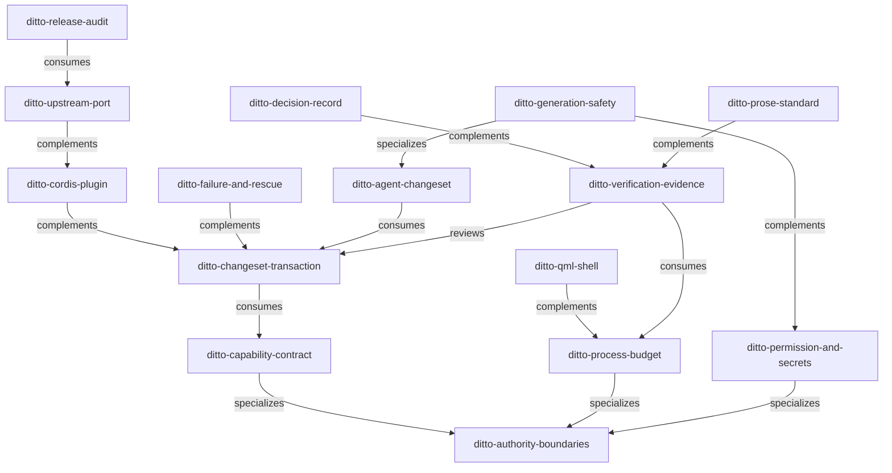

# Ditto Skills Relationship Map

> 關係的權威來源是 [plan/01/02 §3 關係摘要](../../plan/01/02-skill-taxonomy.md#3-關係摘要)；各 skill 的 `metadata.related` 必須與之一致，由 lint 驗證。

## 關係類型

| 類型 | 方向 | 意義 |
|---|---|---|
| generalizes | A generalizes B | A 是 B 所屬領域的上游總則 |
| specializes | A specializes B | A 是 B 的特化 |
| complements | A ↔ B | 兩者併用才構成完整能力 |
| consumes | A consumes B | A 取用 B 的產出或資料 |
| reviews | A reviews B | A 評審／稽核 B 的產出 |

下方圖表由 `node scripts/lint-skills.mjs --write-index` 產生，請勿手改。

<!-- BEGIN GENERATED lint-skills.mjs — do not edit between markers -->

| From | To | 類型 | 說明 |
|---|---|---|---|
| `ditto-capability-contract` | `ditto-authority-boundaries` | specializes | 契約設計是所有權裁決的下游 |
| `ditto-process-budget` | `ditto-authority-boundaries` | specializes | 程序邊界是所有權在資源面的展開 |
| `ditto-permission-and-secrets` | `ditto-authority-boundaries` | specializes | 授權主體歸屬源自所有權模型 |
| `ditto-changeset-transaction` | `ditto-capability-contract` | consumes | 交易依賴能力描述子的 readback／冪等／取消 |
| `ditto-cordis-plugin` | `ditto-changeset-transaction` | complements | 宿主內生命週期與跨宿主交易需一併成立 |
| `ditto-failure-and-rescue` | `ditto-changeset-transaction` | complements | 失敗路徑是交易的另一半 |
| `ditto-agent-changeset` | `ditto-changeset-transaction` | consumes | Agent 產出交由交易層驗證與執行 |
| `ditto-generation-safety` | `ditto-agent-changeset` | specializes | 生成是規劃路徑中最受限的一條 |
| `ditto-generation-safety` | `ditto-permission-and-secrets` | complements | 隔離與授權共同構成信任邊界 |
| `ditto-qml-shell` | `ditto-process-budget` | complements | 熱路徑禁令由兩者共同落實 |
| `ditto-verification-evidence` | `ditto-process-budget` | consumes | 量測方法驗證資源預算 |
| `ditto-verification-evidence` | `ditto-changeset-transaction` | reviews | 「完成」宣稱需回讀證據 |
| `ditto-decision-record` | `ditto-verification-evidence` | complements | 決策需附量測依據 |
| `ditto-upstream-port` | `ditto-cordis-plugin` | complements | 移植的 Cordis 套件同時受兩者約束 |
| `ditto-release-audit` | `ditto-upstream-port` | consumes | 發行審查彙整各套件的移植紀錄 |
| `ditto-prose-standard` | `ditto-verification-evidence` | complements | 誠實語氣需要證據支撐 |

<!-- END GENERATED lint-skills.mjs -->
