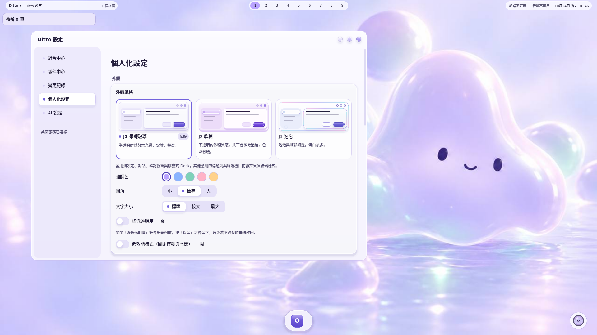
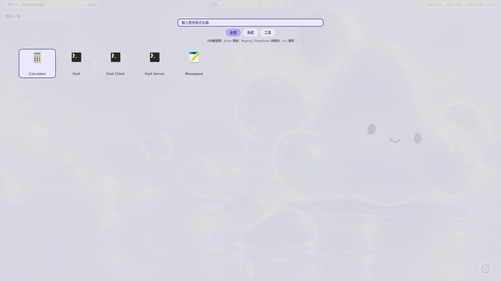

# Ditto — AI-native OS

Ditto 是以使用者意圖與 AI 互動為入口的 Linux 作業系統專案。你描述想怎麼工作，Ditto 透過可組合的桌面與插件調整工作環境，讓桌面配置可以檢查、保存、繼續修改與回復。

預設的 **Soft Jelly／柔光果凍** 以柔和色彩、果凍質感與 Ditto 助理呈現這個工作環境；其他桌面組合可以有自己的風格。

> [!IMPORTANT]
> **桌面 MVP 已由 owner 依 [D-49](.agents/notes/decisions/2026-10-21-d49-g4-mvp-owner-acceptance.md) 接受（2026-10-21）。完整 Linux 發行版仍在推進。**
> MVP 接受不等於全部 G4、效能、資源與硬體驗收通過；正式映像與安裝器尚未交付。目前適合願意參與原生桌面開發與測試的 Linux 使用者。

想先了解產品，從下方的工作情境開始；想動手開發，直接看[從原始碼開始](#從原始碼開始)。



原生 Soft Jelly 桌面與個人化設定，擷取自 main `1d055ce` 的隔離 Ubuntu 26.04 無頭、軟體繪製容器工作階段。網路管理與音效服務在此擷取環境未啟動。

## 讓工作環境跟著意圖改變

Ditto 希望讓「我要怎麼工作」成為作業系統的起點：把工作列移到側邊、換成搜尋式啟動器、調整工作區與通知，再把結果存成下一次可用的桌面組合。對話是控制入口，改變會落到真正的 Linux 桌面與原生應用。

目前原生實作已接通的範圍包括：

| 你想完成的事 | 現有入口與結果 |
| --- | --- |
| 調整桌面 | 對話可修改已支援的配置，個人化設定提供外觀調整；實際可用操作由能力目錄決定 |
| 換一種操作方式 | 替換 Dock 與網格／搜尋式啟動器，透過正式變更流程切換 |
| 保存工作環境 | 組合中心管理 Profile，查看差異、切換組合、匯入與匯出 |
| 看清楚改了什麼 | 變更卡與變更紀錄顯示結果；可回復的桌面變更可撤銷，衝突或不可回復項另行說明 |
| 擴充小型功能 | 受限生成提供待辦摘要與工作區動作兩種固定模板，經驗證並發布後才可啟用，可先預覽 |
| 處理桌面故障 | 救援介面與 CLI 可停用故障插件、恢復最近可用組合；救援底座不依賴 Agent 或 Cordis |

這些是目前實作範圍，不是每一種自然語言要求都能完成的保證。原生介面與開發操作見 [Shell 文件](shell/README.md)，生成限制見[固定模板邊界](docs/platform/generated-template-boundary.md)。



網格啟動器顯示容器內實際安裝的應用程式；擷取自 main `1d055ce` 的隔離 Ubuntu 26.04 無頭、軟體繪製容器工作階段。

## 適合誰

- **想塑造自己工作流的 Linux 使用者與開發者**：參與測試對話改造、手動調整與組合回復。
- **桌面與互動設計貢獻者**：改善 Soft Jelly、啟動器、設定與助理，保留清楚的狀態、鍵盤操作與減少動畫路徑。
- **系統、插件與 Agent 開發者**：擴充正式能力與可替換元件，讓新的功能也能被檢查、授權與回讀。

如果你需要可直接取代日常主系統的完整發行版，請先看[目前邊界](#目前邊界)；目前仍需要開發環境與相應的 Linux／Wayland 經驗。

## AI 如何成為系統入口

使用者透過對話表達需求，Agent 發現可用能力並提出結構化的 `ChangeSet`。Rust Core 驗證配置、權限與版本，再協調桌面元件套用，依實際回讀判定提交或回復。GUI 與 Agent 使用同一套正式能力與授權入口。

```text
使用者意圖／對話              手動設定／快捷鍵
        │                          │
        └──────── 正式能力 ─────────┘
                       │
             Rust Core＋SQLite
             配置、權限、交易與回讀
                 │           │
          Cordis 桌面服務   Quickshell／QML
                 └─────┬─────┘
                 Wayfire／Wayland
                   原生 Linux 應用
```

Agent 按需啟動；桌面服務依組合與服務需求持續運作。Agent 退出不會讓 Dock、待辦或通知策略跟著停止。拖曳與動畫留在本機 UI，不逐幀等待模型。

AI-native OS 描述的是整個工作環境的互動與控制方式。Linux 核心與驅動沿用既有生態；Agent 經受控能力操作，不取得任意 root 控制權。雲端模型仍需連線與相應帳號或 API 金鑰，Codex 訂閱路徑另有隔離條件；手動桌面與服務的獨立生命週期不代表全部 AI 功能可離線使用。

## 目前邊界

| 項目 | 現況與依據 |
| --- | --- |
| 桌面 MVP | owner 已接受；未取得的 G4／NFR 出口證據仍是缺口，見 [D-49](.agents/notes/decisions/2026-10-21-d49-g4-mvp-owner-acceptance.md) |
| Linux 發行版 | owner 選定 Ubuntu-first，目標有完整映像與既有 Ubuntu Desktop 上安裝套件兩種形態；Fedora 工作暫停。選型見 [D-51](.agents/notes/decisions/2026-10-24-d51-ubuntu-mkosi-base.md) 與[雙形式 ADR](docs/platform/distro-architecture.md)，owner 原始決定見 [#148 留言](https://github.com/relvo-labs/Ditto/issues/148#issuecomment-6384379418)；這不是可下載產品的宣告 |
| 安裝與升級 | 目前倉庫保留原生開發與參考工作階段工具；完整 release 映像、正式安裝器與生產升級信任鏈尚未完成。已合併的 [Ubuntu 26.04 建置配方](packaging/distro/ubuntu/README.md)仍待從 repo 完整重建驗證，不能當作可發行映像 |
| 模型連線 | 已有 Codex 訂閱／app-server 與 API 金鑰路徑，需相應帳號或 API 金鑰與秘密儲存。Codex 訂閱路徑另需隔離支援及 Landlock ABI ≥6；無法提供此隔離時，API 金鑰路徑仍可使用。版本與條件見[支援矩陣](docs/platform/support-matrix.md#codex-訂閱連線的開發環境相容性) |
| 生成與安裝 | 現有生成限兩種固定模板；任意程式生成、任意第三方插件自助安裝仍未完成，見[生成邊界](docs/platform/generated-template-boundary.md) |
| 硬體與無障礙 | Secure Boot、廣泛 NVIDIA／硬體支援、實體雙螢幕與完整輔助科技驗收仍未完成；參考機結果不能泛化為全硬體保證 |
| 外觀與應用 | Soft Jelly 主要控制 Ditto 自有介面與支援的裝飾，不承諾重繪所有第三方應用 |

歷史接受與量測保留在 [G0](.agents/notes/gate-reviews/G0-exit.md)、[G1](.agents/notes/gate-reviews/G1-exit.md)、[G2](.agents/notes/gate-reviews/G2-exit.md)、[G3](.agents/notes/gate-reviews/G3-exit.md) 評審；各紀錄只代表其來源版本與環境。

## 從原始碼開始

目前沒有本頁已驗證、供一般使用者短時間完成的原生安裝路徑。請先走原始碼開發入口，在獨立的測試環境準備相依工具；瀏覽器原型不作為 OS 試用入口。

1. **確認平台與工具鏈**：讀[支援矩陣](docs/platform/support-matrix.md)，核對 Rust 1.98.1、Node 22.23.2、pnpm 10.11.0、Qt 6.10.2、Quickshell 0.3.1 與 Wayfire 0.11.0。矩陣凍結的是參考證據條件，不是一般使用者最低規格承諾。
2. **選擇原生開發入口**：讀 [Shell 的開發執行方式](shell/README.md#在開發環境執行)，了解內建套件、Core、Shell 與 hostd 如何接線。這需要先建置 Rust 二進位與 hostd；該段不是全新主機的一鍵安裝流程。需要參考工作階段重建時，再查[參考環境工具](packaging/reference-image/README.md)。
3. **以小型、可回讀的變更作為第一次成功**：原生工作階段就緒後，先從個人化設定改一項外觀，查看變更紀錄並撤銷；再設定模型連線，測試同一個有支援能力的需求。用實際畫面與配置回讀確認結果，不只看助理文字。

這個入口提供開發導覽；本頁所連結的開發模式入口、主機安裝、登入管理器與上述完整首次操作流程尚未重新驗證。若啟動受阻，先核對工具版本、合成器與 Core／Shell 診斷，不以停用隔離或借用日常 Profile 繞過問題。

## 依你的工作找文件

| 你要做什麼 | 從這裡開始 |
| --- | --- |
| 理解產品要求與使用情境 | [PRD v0.4.0](docs/product/Ditto-PRD-v0.4.0.md)；後續接受與發行方向以 D-49 及上述 owner 決定為準 |
| 理解系統分工與開發規則 | [架構](milestones/01/01-architecture.md)、[AGENTS.md](AGENTS.md)、[skills](.agents/skills/README.md) |
| 開發桌面介面與插件 | [Shell](shell/README.md)、[Shell 擴充契約](docs/contracts/shell-extensions.md)、[Cordis 沿用紀錄](docs/upstream/cordis-port.md) |
| 參與發行版工程 | [D-51 底座決策](.agents/notes/decisions/2026-10-24-d51-ubuntu-mkosi-base.md)、[雙形式 ADR](docs/platform/distro-architecture.md)、[Ubuntu 映像配方](packaging/distro/ubuntu/README.md)；配方尚未完成重建資格驗證 |
| 檢查平台與原生視窗能力 | [支援矩陣](docs/platform/support-matrix.md)、[合成器能力差異](docs/platform/compositor-capability-matrix.md)、[合成器探針](tools/compositor-probe/README.md) |
| 驗證交易、生成與故障路徑 | [驗收矩陣](milestones/01/04-verification.md)、[G1 測試入口](tests/g1/README.md)、[G3 測試入口](tests/g3/README.md) |
| 查階段計畫與整合工作 | [里程碑](milestones/01/README.md)、[G4 計畫](plan/06/README.md)、[G4 追蹤](https://github.com/relvo-labs/Ditto/issues/42)；計畫不等於已交付 |
| 研究早期互動設計 | [研究與互動決策](docs/research/RESEARCH-AND-INTERACTION.md)、[凍結的瀏覽器原型](apps/desktop-prototype/)；原型的本機規則解析與示範資料不代表原生能力 |

## 倉庫導覽

| 路徑 | 內容 |
| --- | --- |
| `crates/` | Rust 契約、Core、SQLite 儲存、系統與合成器轉接、CLI、監督與隔離工具 |
| `packages/`、`schema/` | Cordis hostd、Agent、SDK、桌面服務、Rust 匯出的 schema 與 TypeScript 契約 |
| `shell/` | Quickshell／QML 桌面、供應者、管理中心、對話、救援與鎖定介面 |
| `packaging/`、`tools/` | 參考環境、工作階段與平台建置／診斷工具 |
| `tests/`、`scripts/` | 契約、整合、故障與量測入口；已配置的檢查不代表 CI 已通過 |
| `docs/`、`milestones/`、`plan/`、`.agents/` | 需求、設計、計畫、接受證據、決策與開發規則 |
| `apps/desktop-prototype/` | 凍結的歷史互動參考 |

## 致謝與來源

Ditto 的組合設計深受 [DeepSeek Harness](https://github.com/deepseek-ai/deepseek-harness) 啟發，桌面服務宿主沿用其 vendored [Cordis](https://github.com/cordiverse/cordis) fork。概念借鑑、實際取用程式碼與 Ditto 自行新增的桌面交易／回讀能力分別記錄在[來源導覽](docs/upstream/deepseek-harness.md)、[Cordis 移植紀錄](docs/upstream/cordis-port.md)與 [Agent 值模組移植紀錄](docs/upstream/harness-g2-port.md)。

Ditto 是獨立專案，與 DeepSeek 沒有隸屬或背書關係。Ditto 自有程式碼依 owner 2026-10-25 的 [D-52 決定](.agents/notes/decisions/2026-10-25-d52-mit-license.md) 採 [MIT 授權](LICENSE)，著作權為 `2026 Ditto contributors`。Linux、Ubuntu、Qt、Wayfire 等相依元件、第三方插件與素材仍依各自授權；上游程式碼的 LICENSE／NOTICE 必須保留。名稱、商標、角色與美術素材、owner／使用者生成物不因本決定而取得 MIT 授權；完整映像與第三方義務也未因此完成法律審查。其餘法律裁定仍依 [D-49](.agents/notes/decisions/2026-10-21-d49-g4-mvp-owner-acceptance.md) 由 owner 負責。

來源授權一致性檢查：依 `.nvmrc` 啟用 Node 後，執行 `node scripts/check-license.mjs` 與 `node --test scripts/check-license.test.mjs`。此檢查不代替發行包的完整授權盤點。

---

本頁由專案維護者隨已合併能力、owner 決策與發行交付更新；安裝路徑、平台版本或預設桌面改變時，需重新核對入口、限制與畫面來源。
