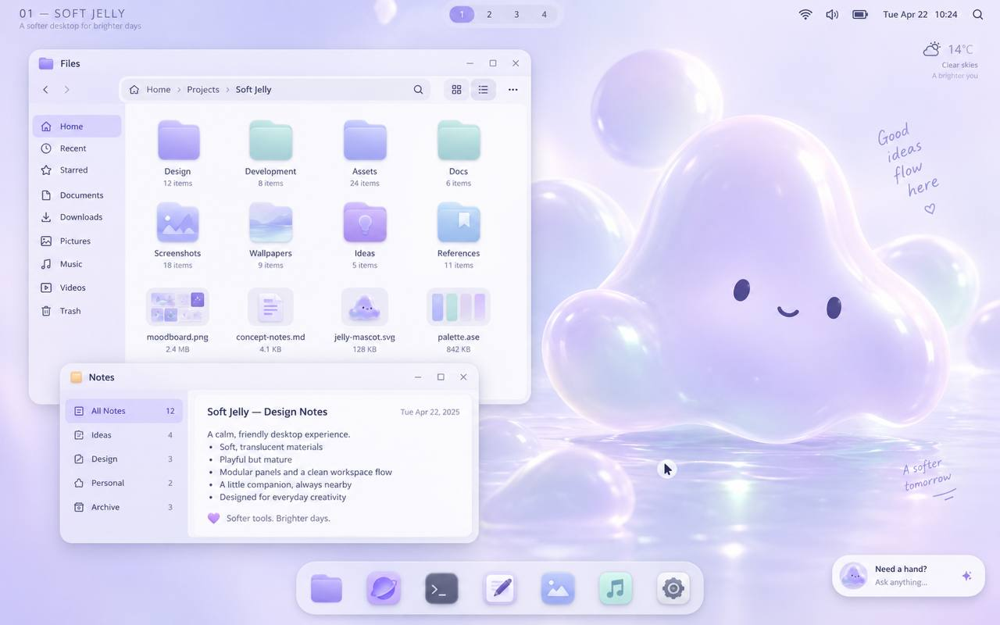

# 預設桌面：效果圖還原與右下助理總規劃

| 文件屬性 | 內容 |
| --- | --- |
| 版本／日期 | 0.1.0／2026-10-17 |
| 狀態 | 已完成首輪研究的執行提案；**沒有 UI 實作或驗收通過宣稱** |
| 程式碼盤點基底 | `39da2977fa1a819033b4a68a3cdf350e2b32f808` |
| 所屬 | G4 #42；平行於 #43／PR #62 的階段文件工作 |
| 需求來源 | owner 在 Telegram 提供本圖並要求：預設畫面做到一樣，涵蓋 UI、果凍感、動態；右下 Ditto 改成助理，因桌布已有 Ditto；研究優秀桌面與相關專案，優先易用性；先交總規劃與 GitHub issues |

## 1. 設計目標，不再只做到「紫色主題」

**這張圖是預設桌面的視覺目標，外部 benchmark 只提供方法，不取代它。** 要還原的是淺薰衣草桌布、近白柔光表面、細邊與柔影、左側工作視窗的前後層次、底部置中的彩色圖示 Dock，以及右下小型助理入口。不能用深色玻璃、文字 app ID Dock 或大型新吉祥物宣稱已完成。

原圖 `1280×800`，SHA-256 `ef4cc303391408dd2dc2f35953ae91c47462fa8fde39ce9436b807c8a80d5d12`。本檔是必要的需求參考，不是新生成的驗收圖片；附圖不代表素材已取得產品散布授權，也不是可直接鋪滿的桌布檔。

### 已確定與待決定

- **owner 已明確要求**：預設視覺忠實還原；右下是助理，不再重複 Ditto 角色。這兩點不再問一次是否需要。
- **相容性提案**：變更新預設呈現；不擅自刪除既有 `AvatarSettings` 或重寫使用者已選的 Profile。技術契約與權威文件如何更新，列入助理工作包。
- **待核定**：乾淨桌布／圖示來源與權利、助理符號／名字、左上標題與副標是 caption／桌布還是真 widget、兩個前景應用是否自動開啟、天氣是否真功能、具體色碼與動態參數。原圖右下左側確實是小 Ditto 頭像；依 owner 指令替換，非 Ditto 頭像或中性符號都只作候選，定案後列入偏離帳。缺少素材不授權 Agent 假造相同圖或對外散布角色。

## 2. 證據分層

| 標記 | 能說什麼 | 不能說什麼 |
| --- | --- | --- |
| 圖片可見 | 構圖、相對配色、表面層次、可辨識內容 | 動畫曲線、精確字體／色碼／blur 半徑、可操作性 |
| owner 指定 | 桌布已有 Ditto、右下改助理 | 所有未提到的舊 Profile 都要遷移 |
| 固定原始碼 | 基底內的型別、預設、渲染路徑 | 已部署畫面、效能、IME 或螢幕閱讀通過 |
| 官方文件／專案原始碼 | 規範、機制與限制 | Ditto 已具備相同 API、視覺或效能 |
| 提案 | 將研究轉成設計與驗收契約 | owner 已核定或產品已完成 |

圖片已透過研究 lane 的原生附圖檢視；圖片分析 API 另一路遇到額度限制，未以失敗結果補造觀察。這一輪沒有啟動 QML、量測 GPU／PSS、操作外部產品或招募測試者。

## 3. 交付分工與既有 G4 去重

| 工作包 | 唯一主責 | 重用，不重做 |
| --- | --- | --- |
| R1 構圖與材質 | 桌布／圖示接點、淺色 token recipe、柔光表面、頂部／Dock／助理錨點與元件一致性 | #45 的組合與供應者綁定；#49 輸出規則；#51 資產權利 |
| R2 果凍動態 | 原生可中斷 choreography、狀態終止、材質 capability 與無特效降級 | #46 舊角色動畫、#47 偏好、#52／#53 量測 |
| R3 右下助理 | 預設呈現契約、同一會話、compact／完整視窗錨點、焦點／IME、legacy 相容 | #46 角色能力；#47 全域可及性；Core 既有 approval／preview／cancel／undo |
| R4 聯合驗證 | 同一 target 的視覺場景、狀態、NFR、可及性與易用性證據索引 | #56 回歸、#52 效能、#53 資源、#57 使用者測試 |

R1～R4 各有獨立 issue，既有 #45／#46／#47 保留在 #42 底下，不改其 parent，也不重複建立「可縮放角色」「再做 IME」「另一套效能 suite」。來源與可移用邊界見 [benchmark](benchmarks.md)，完整契約見 [設計契約](design-contract.md)，相依與驗收見 [工作與驗收](workplan-and-acceptance.md)。

## 4. 兩個場景必須分開

1. **首次登入場景**：真正可用的桌布、Shell、狀態、Dock 與助理。是否自動開 Files／Notes 尚待 owner 決定；不能偷偷把圖中兩窗排除在對照之外。
2. **效果圖對照場景**：用真實可操作的支援應用重現左側前後雙窗；示範內容標 fixture，不宣稱是使用者真資料。不能把含視窗、時間、Dock 的整張圖當桌布，產生假 UI。

Ditto 自有介面應一致；第三方應用內部外觀只能對明確支援的工具與裝飾提出方案，不保證任意重繪所有應用。沒有乾淨桌布與合法素材時，可以先完成不依賴素材的契約／原生 spike，但忠實視覺還原保持未完成。

## 5. 完成定義

- 能逐元件對照原圖，而非只有一張漂亮 happy-path screenshot；偏離原圖的地方逐項列理由並交 owner 確認。
- 右下助理沿用 Core 真實狀態和可逆流程，關閉不是取消、未知不是成功、離線不妨礙手動桌面。
- 原生 QML capture、低特效、鍵盤、繁中 IME、大字、screen reader、多屏與中斷情境都有可追溯證據。
- 效能、動畫與資源使用沿用既有 NFR 與實體參考機規則；研究與規劃通過不等於這些測試通過。
- 所有新 UX 數字都先標提案，不能以「極致易用」宣稱沒有做過的人體比較實驗或自行放寬原門檻。
