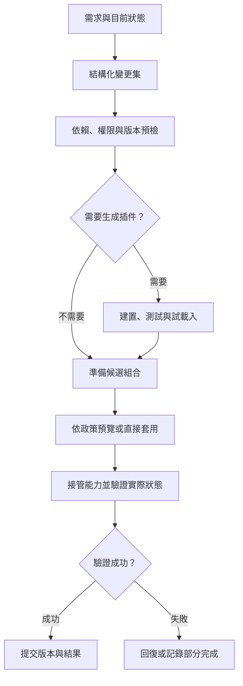
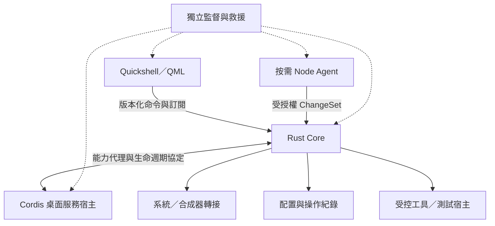

# Ditto｜對話驅動的可組合桌面系統

產品需求文件（PRD）

| 文件屬性 | 內容 |
| --- | --- |
| 文件編號 | DITTO-PRD-001，承接 CLD-PRD-001 |
| 版本 | 0.4.0 |
| 日期 | 2026-09-19 |
| 狀態 | 完整規劃草案；已確認方向與建議基線分列 |
| 產品名稱 | Ditto |
| 預設桌面 | Soft Jelly／柔光果凍 |
| 已選定桌面技術 | Qt Quick＋Quickshell，QML |
| 適用讀者 | 產品、設計、桌面工程、Runtime／Agent 工程、插件開發與測試團隊 |
| 本版主題 | 恢復 Cordis 為主要插件組合基礎；明確分工 Rust Core、Cordis 服務宿主與按需 Agent，修正生命週期、資源預算與驗收 |

> Ditto 是一套讓使用者透過對話持續塑造工作環境的可組合 Linux 桌面系統。桌面的外觀、布局、操作方式與功能由插件組成；LLM 理解需求，透過正式能力介面修改配置、組合與安裝插件，必要時建立新插件。結果可保存、切換、檢查與回復。

Ditto 同時是專案名稱與預設角色名稱。角色、聊天介面、模型與 Agent 執行環境皆可替換。柔光果凍是開箱即用的預設組合，不限定所有桌面都維持相同風格。

本文件定義待實作的產品要求，不代表功能已完成。效能與成功率均為建議驗收目標，須以原生原型量測。已有網頁原型作為視覺與互動參考，不構成原生能力或模型接入的驗證。

## 1. 產品決策基線

### 1.1 已確認

| 項目 | 決策 |
| --- | --- |
| 核心產品 | 以 LLM 對話驅動的可組合 Linux 桌面系統 |
| 主要使用方式 | 使用者描述需求，系統實際改變桌面並支援持續修正 |
| 桌面能力 | 介面、布局、操作策略、系統整合與 AI 能力具明確模組邊界 |
| 桌面呈現 | Qt Quick＋Quickshell，使用 QML |
| 組合底座 | 以 Cordis 為主要插件組合模型與 JavaScript／TypeScript 服務宿主；Rust 提供系統核心與受控服務邊界 |
| Agent 執行 | Node.js／TypeScript 獨立 Agent 程序，按需啟動；與 Cordis 桌面服務宿主的生命週期分離 |
| Agent 生態 | 選擇性移植 DeepSeek Harness 與適合的插件；可修改上游，不承諾全面零修改相容 |
| 預設形象 | 柔光果凍桌面，桌面內的 Ditto 角色可動且可點擊對話 |
| 模組定位 | 插件可提供服務、行為或 UI；單一插件不等同整套 Harness |
| 原生要求 | 管理真正的 Linux 應用程式，不以網頁內假視窗取代 |

### 1.2 建議工程基線

| 項目 | 本版建議 | 決策狀態 |
| --- | --- | --- |
| 交付形態 | 安裝於既有 Linux 的獨立桌面工作階段 | 建議 |
| 平台 | 一個固定發行版／版本、x86_64、參考 GPU | G0 決定 |
| 顯示底層 | Wayland；Wayfire 為首選驗證候選 | 尚未定案 |
| 常駐桌面核心 | Rust；權威配置、變更協調、能力路由、權限、宿主監督與回復 | 本版已採用 |
| 桌面插件宿主 | Node.js＋Cordis；Context、服務依賴、事件、作用域與插件掛載／清理 | 本版已採用；按服務需求常駐 |
| 桌面 UI 插件 | QML／宣告式組合；可信 UI 由 Quickshell 宿主管理 | 本版已採用 |
| Agent 與工具整合 | Node.js＋TypeScript 按需 Agent；Harness 可在其內使用 Cordis，並調用獨立桌面宿主的能力 | 方向已採用；移植範圍 G2 驗證 |
| 一般腳本宿主 | 嵌入式 JS／Lua 列 P1 評估，不作 MVP 依賴 | 尚未選型，不承諾 npm 相容 |
| 程序通訊 | Unix socket＋版本化 JSON-RPC／事件協定 | 技術設計定案 |
| 持久資料 | SQLite＋可匯出的宣告式配置與版本鎖定檔 | 建議基線 |
| 系統整合 | 既有 D-Bus 服務、systemd 使用者服務或等效監督機制 | 依平台驗證 |
| Ditto 動畫 | 分層 2D 素材＋QML 動畫，按需加入 Shader | 首版方案 |
| 模型 | 先接一個供應者，保留替換介面 | 供應者待選 |

AI 是完整產品預設提供的主要入口；離線、未設定金鑰或停用 AI 時，手動桌面仍須正常運作。這是故障降級要求，不降低對話改造能力的產品優先級。

本版修正 v0.3.0 將 Cordis 降為可選 Agent 內部實作的定位。Cordis 同時是組合架構的主要參考與實際使用的 TS 插件宿主；Rust 不全面重寫 Cordis，也不要求將其插件逐一移植為 Rust。兩者的權威範圍明確分工：Rust 管持久配置、授權及提交，Cordis 管宿主內的依賴與插件實例；不各自保存互相競爭的正式配置。Agent 是能力使用者，並非 Cordis 的唯一使用情境。

## 2. 問題、目標與非目標

桌面客製化目前常分散在設定頁、配置檔、Shell 腳本與不同擴充之間。使用者需要知道工具名稱與實作細節，才能把「我想怎麼工作」轉成可用環境。擴充間的衝突、版本與復原也增加維護成本。

Ditto 將工作意圖、可組合能力與可驗證的執行連成完整流程。使用者不用理解插件依賴圖，仍能取得可追溯、可重現的桌面。

### 2.1 產品目標

1. 以自然語言完成跨插件的桌面改造，能在後續對話微調。
2. 將外觀、布局、快捷鍵、行為、資料來源與工具組合成可保存的工作環境。
3. 現有能力不足時，提供插件搜尋、安裝、移植與生成的擴充路徑。
4. 改造過程保留現有應用與工作；失敗有明確結果與回復入口。
5. GUI、快捷鍵、Agent 與自動化共用服務契約，結果一致。
6. 預設組合完整、易用、有辨識度，進階使用者可逐步替換任何有替換契約的部分。

### 2.2 非目標與範圍界線

- 首版不開發 Linux 核心、驅動或自製完整合成器。
- 不要求 GTK、Qt、瀏覽器等既有應用改寫為 Ditto 插件。
- 不承諾透過桌面主題強制修改所有第三方應用的內部介面。
- 不承諾任何自然語言需求均能實現；超出能力時應說明缺口與可行下一步。
- 不承諾任意第三方插件直接相容，或所有插件都可無縫熱換。
- 不把修改桌面配置等同修改文件、寄信、付款等外部副作用的可撤銷性。
- MVP 不包含公開付費市場、跨設備同步、企業集中管控與全硬體支援。
- MVP 不提供不受限制的生成程式碼自動執行；受限生成仍須形成可使用的插件。

## 3. 使用者與產品成功定義

| 使用者 | 需求 | Ditto 提供的價值 |
| --- | --- | --- |
| 進階 Linux 使用者與開發者 | 自訂工作流、工作區與工具 | 用對話組合並保存環境 |
| 知識工作者 | 在研究、簡報、日常工作間切換 | 描述目的即可得到可調整的桌面 |
| 插件開發者 | 擴充介面、服務與 Agent 能力 | 穩定契約、測試宿主、範例與診斷 |
| 維護者 | 管理版本、支援與故障 | 固定依賴、可重現配置與救援 |

MVP 優先服務願意參與測試的前兩類使用者。核心成功情境：使用者透過一段對話完成跨三類能力的桌面改造，接著微調、保存及撤銷；無需手動編輯配置檔，既有應用保持執行。

## 4. 核心概念

| 概念 | 定義 |
| --- | --- |
| Plugin／模組 | 可安裝、啟停、版本化的功能單位，兩詞在本文同義 |
| Capability／能力 | 可被發現與呼叫的服務、命令、設定或 UI 擴充點 |
| Provider／供應者 | 實作某個能力契約的插件 |
| Profile／桌面組合 | 插件實例、版本、供應者、布局、外觀、快捷鍵與設定的宣告 |
| Bundle | 一起安裝或啟用的插件集合 |
| Workspace／工作區 | 使用中的視窗分組與活動空間；與 Profile 不同 |
| ChangeSet／變更集 | 一次需求產生的結構化變更、預檢、執行步驟與回復資訊 |
| Desired／Observed State | 宣告的目標配置／系統實際觀測到的狀態 |
| Harness | 模型、工具、會話與 Agent 執行流程的組合環境 |
| Skill／MCP | 工作指引／外部工具協定，需由適用插件整合 |
| 救援底座 | 不依賴可替換聊天介面或故障插件的最低操作與回復能力 |

「可組合」涵蓋功能與行為，不只主題。模組化、可替換與熱換是不同層級；插件包與作業系統程序不必一對一。

## 5. 主要使用旅程

### 5.1 首次登入

直接進入柔光果凍桌面，具 Dock、啟動器、工作區、通知與預設角色。使用者可略過模型設定先使用桌面；連接模型後提供三個能真的執行的例子：「把 Dock 放左邊」「做一個專注工作區」「建立新的桌面組合」。首次對話用簡短語句說明目前可操作範圍，金鑰存入秘密儲存。

### 5.2 以對話改造桌面

使用者：「幫我做一套寫程式用的桌面，左邊放專案，右邊保留終端，通知不要一直跳。」

系統讀取已授權的配置與視窗資訊，辨識可用插件，建立變更集；修改布局、啟動器內容與通知模式。若「專案」無法確定，提供候選或採可逆的空白專案區，避免憑空指定私人資料夾。完成後顯示變更摘要、儲存與撤銷入口。

使用者接著說：「終端再寬一點，顏色維持原本的。」系統只修改相應布局，不重新覆蓋整個組合。

### 5.3 替換插件

使用者：「這個啟動器換成搜尋式的。」系統優先查已安裝插件，其次查核可來源，檢查所需能力、相容版本與權限。安裝與啟用分開記錄；替換後保留應用索引及可遷移設定。

### 5.4 建立新功能

使用者：「做一個顯示目前專案待辦的小面板。」系統確認資料來源，若已有待辦服務則組合；若缺少 UI，生成符合 SDK 的插件，在測試宿主試載入並顯示預覽，啟用後可繼續用對話修改。若缺資料來源權限，先提供使用者可識別的示範資料，不能冒充真實進度。

### 5.5 保存、切換與回復

使用者：「存成開發模式，再做一套簡報模式。」保存不可變配置版本，再建立新組合；不自動關閉既有應用。「還原剛剛的變更」定位到最近完成的相關變更集，先檢查後續修改與回復可行性，再撤銷相應部分。

### 5.6 故障與離線

模型中斷時仍可手動操作桌面；已開始執行的變更由獨立協調器判定提交或回復。插件崩潰時救援介面可停用插件、恢復最近可用配置。無法完成時，對話顯示真實狀態，而非持續假裝工作。

## 6. 產品介面與資訊架構

| 介面 | 主要內容 |
| --- | --- |
| 桌面 | 背景、角色、Dock、面板、工作區與原生應用 |
| 對話面板 | 訊息、上下文範圍、變更卡、進度、取消、撤銷、歷史 |
| 組合中心 | 已存組合、複製、差異、預覽、套用、版本與匯入匯出 |
| 插件中心 | 已安裝、核可來源、安裝與啟用狀態、權限、版本、診斷 |
| 個人化設定 | 外觀、快捷鍵、角色、動畫、語言與無障礙 |
| AI 設定 | 模型連線、秘密引用、授權範圍、費用與任務預算 |
| 變更歷史 | 需求、實際差異、執行結果、來源、回復條件 |
| 救援介面／CLI | 停用失敗插件、恢復可用組合、查看必要診斷 |

一般流程呈現「工作列位置」「影響中的工作」等產品語言；契約 ID、程序資訊、原始錯誤與日誌放在可展開診斷中。

## 7. 對話與意圖執行需求

| ID | 優先 | 需求與完成條件 |
| --- | --- | --- |
| CON-01 | P0 | 支援繁中、英文與多輪修正；能把「再窄一點」「保留原色」對應到最近變更目標 |
| CON-02 | P0 | 對話可修改外觀、布局、插件選擇與行為設定，至少一次跨三類能力完成 |
| CON-03 | P0 | 動態取得能力目錄及 schema；不可憑空產生不存在的命令後宣稱成功 |
| CON-04 | P0 | 目標含糊且影響實際資料或應用時，提供具體選項；有合理可逆預設時直接繼續 |
| CON-05 | P0 | 模型產生結構化變更集，經確定性驗證後執行；自然語言文字不直接當權威配置 |
| CON-06 | P0 | 顯示正在理解、準備、試用、套用、驗證等實際階段；長操作可取消 |
| CON-07 | P0 | 每個結果包含成功、失敗、部分完成或結果未知，完成判斷依系統回讀 |
| CON-08 | P0 | 支援對話保存、切換、比較與撤銷組合，對話可連結相應變更集 |
| CON-09 | P0 | 模型斷線後保留訊息與執行狀態；重連先查操作結果，不盲目重跑 |
| CON-10 | P0 | 按風險與已有授權決定確認：有界且可逆的配置預設直接執行，避免重複詢問 |
| CON-11 | P0 | 未支援需求清楚說明缺少的能力，提供組合、安裝或生成路徑 |
| CON-12 | P1 | 圖片、參考布局可作為設計輸入；先形成可檢查方案再套用 |
| CON-13 | P1 | 語音輸入與朗讀可作為可選插件，不綁定核心對話 |

上下文分級：桌面配置、視窗中繼資料、指定文件、剪貼簿、截圖分別授權。預設不持續截圖、不自動上傳所有視窗內容。對話面板以簡短標籤顯示本次使用哪些上下文，允許移除。

## 8. 三條桌面改造路徑

| 路徑 | 適用需求 | 主要流程 | MVP 範圍 |
| --- | --- | --- | --- |
| 配置修改 | 位置、顏色、尺寸、快捷鍵、通知模式 | schema 驗證→差異→套用→回讀 | 完整支援 |
| 插件組合 | 替換啟動器、新增面板、連接工具 | 發現→解析依賴→預檢→準備→啟用 | 已安裝及核可來源 |
| 插件生成／改造 | 既有能力不能滿足的新 UI 或邏輯 | 需求→程式→建置→測試→試載入→啟用 | 受限 UI／既有能力組合模板 |

不得將配置修改偷偷改成任意 Shell 命令或原始碼改寫。若需改走生成路徑，顯示這是新增插件，並套用對應測試與執行規則。

執行優先序為「修改宣告式配置→組合現有元件／能力→生成受限插件→新增受控外部工具」。位置、主題、待辦面板實例等一般需求不得要求重新編譯 Rust 核心、重啟整個桌面或常駐一個新 Node 程序。MVP 不開放 Agent 生成並直接載入任意原生動態庫。

## 9. 插件生成與移植需求

| ID | 優先 | 需求與完成條件 |
| --- | --- | --- |
| GEN-01 | P0 | Agent 可從官方模板產生新的 QML UI 插件，使用既有核可能力與資料 schema |
| GEN-02 | P0 | 產物包含原始碼、manifest、依賴鎖定、設定 schema、測試／驗證結果與生成來源 |
| GEN-03 | P0 | 生成內容先在隔離測試宿主驗證，不能直接覆寫使用中的 Shell 或救援程式 |
| GEN-04 | P0 | 限制生成插件可用 imports、檔案、網路與程序能力；隔離未建立前只允許受限宣告式模板輸出 |
| GEN-05 | P0 | 通過語法、契約、載入、焦點與基本互動驗證後提供真實預覽，測試資料需標示 |
| GEN-06 | P0 | 啟用失敗自動停用候選並回復；原始碼與診斷可保留供修正 |
| GEN-07 | P0 | 對話修改已生成插件產生新版本，不破壞可回復版本；顯示變更範圍 |
| GEN-08 | P0 | 控制生成與修復迴圈預算；建議最多自動修復三輪，超出後保留結果並說明問題 |
| GEN-09 | P1 | 擴充到受控腳本邏輯、資料連接器與外部插件移植；TypeScript／Node 插件在獨立核可宿主執行，不進 Rust 核心 |
| GEN-10 | P1 | 依 SDK、測試及來源規則，支援較自由的 QML 與第三方依賴 |

可生成不等於可任意執行。QML／JavaScript 同樣可能有檔案與程序能力；靜態掃描或人工確認不能取代執行隔離。MVP 的受限模板至少能產生兩種原先未安裝的有效插件，例如待辦摘要面板與工作區快捷動作面板，不得僅切換預先寫好的外觀冒充生成。

移植分為直接沿用、薄轉接、修改移植、保留外部宿主四種。每個套件記錄固定上游 commit、來源、修改摘要、宿主契約、授權與測試矩陣。MVP 驗證模型適配器、工具、會話或背景工作三類上游能力；具體套件由 G0／G1 盤點決定。桌面新能力以 Ditto 契約為準，不要求永久維持 Harness 內部介面。

## 10. 桌面與原生應用需求

| ID | 優先 | 需求與完成條件 |
| --- | --- | --- |
| DES-01 | P0 | 可登入獨立 Linux 工作階段，啟動原生瀏覽器、終端與編輯器 |
| DES-02 | P0 | 應用搜尋、鍵盤選擇、啟動與執行中視窗列表 |
| DES-03 | P0 | 視窗聚焦、移動、調整大小、最小化、最大化、請求關閉；依平台能力真實回報 |
| DES-04 | P0 | 至少兩工作區與浮動／基本平鋪兩種配置方式，布局策略可替換 |
| DES-05 | P0 | Dock、啟動器、通知、快捷鍵、音量與網路狀態，詳細設定可啟動既有工具 |
| DES-06 | P0 | 安全鎖定、登出與電源入口；使用已驗證系統機制 |
| DES-07 | P0 | 繁中／英文、中文輸入法、文字剪貼簿與預設應用開檔 |
| DES-08 | P0 | 指定雙螢幕、縮放與熱插拔；顯示器消失後視窗及角色回到可見範圍 |
| DES-09 | P0 | 插件切換與 Shell 重啟不得主動終止原生應用或丟失未儲存內容 |
| DES-10 | P0 | 提供至少兩個 Dock／工作列供應者與兩個啟動器供應者，證明可替換性 |
| DES-11 | P1 | 完整 portal、螢幕分享、截圖、藍牙、進階電源及多顯示器矩陣 |

可組合系統需要現實能力表。合成器不支援的操作回傳 unsupported；跨應用一致外觀只涵蓋 Ditto 自有介面及明確支援的裝飾，不承諾重繪第三方應用。

## 11. 柔光果凍與預設 Ditto 角色

### 11.1 預設視覺

採淡紫色、圓潤視窗、柔和陰影、半透明面板與中央 Dock。依 [D-48](../../.agents/notes/decisions/2026-10-17-d48-default-assistant-entry.md)，新 store 的預設組合以右下助理入口開啟對話，不再放重複 Ditto 角色；桌布大型 Ditto 目前按靜態規劃，素材未定。可選角色及舊 Profile 保留可動角色層，尺寸、位置、配色、材質與動畫皆可調整。玻璃效果需兼顧可讀性，提供降低透明度與低效能替代樣式。

### 11.2 角色與對話

| ID | 優先 | 需求與完成條件 |
| --- | --- | --- |
| AVA-01 | P0 | 待命有緩慢呼吸、眨眼及輕微果凍晃動；動畫在本機運作，不等待模型 |
| AVA-02 | P0 | 游標進入角色互動區有注視與靠近反應；全域跟隨僅在合成器介面可行時啟用 |
| AVA-03 | P0 | 新預設點擊有標籤的助理入口展開對話；可選角色模式點擊角色有回彈並展開身旁對話，同一呈現不放重複入口（D-48） |
| AVA-04 | P0 | 待命、思考、執行、待確認、完成、失敗、離線均有可辨識狀態，文字同步表達 |
| AVA-05 | P0 | 原生應用可覆蓋角色，透明區域不攔截點擊；被遮住時可用快捷鍵喚回對話 |
| AVA-06 | P0 | 對話可收起或展開完整視窗，保留草稿、歷史、串流與任務狀態 |
| AVA-07 | P0 | 角色可移動、縮放、隱藏與停用動畫；無角色模式仍能完成所有對話操作 |
| AVA-08 | P0 | 尊重減少動畫、鍵盤焦點與螢幕閱讀需求；不靠晃動或顏色單獨傳達結果 |
| AVA-09 | P1 | 支援替換角色素材與動作映射，模型與對話紀錄不受影響 |

角色外觀、對話 UI、會話儲存、Agent 執行、桌面工具分別具模組邊界。首版角色動作必須服從真實任務狀態，不能用持續思考動畫掩蓋已停止的任務。

## 12. 插件中心與 SDK

| ID | 優先 | 需求與完成條件 |
| --- | --- | --- |
| MOD-01 | P0 | 顯示插件 ID、版本、來源、作者、授權、執行狀態與相容性 |
| MOD-02 | P0 | 預檢 required／optional 依賴、衝突、循環與單一供應者約束 |
| MOD-03 | P0 | 安裝、啟用、停用、替換、更新、回退與移除皆有可查結果 |
| MOD-04 | P0 | 版本鎖定與套件完整性校驗；不因另一插件安裝靜默改寫已用版本 |
| MOD-05 | P0 | 設定、工具、快捷鍵、事件與 UI 註冊有擁有者，卸載後完整清理 |
| MOD-06 | P0 | 移除插件預設保留資料；刪除資料是獨立明確操作 |
| MOD-07 | P0 | 具機器可讀能力描述，讓 LLM 依 schema 發現並使用，描述文字不授予權限 |
| MOD-08 | P0 | SDK 提供 manifest 驗證、服務範例、QML 掛載、命令、測試宿主與救援 CLI |
| MOD-09 | P1 | 簽章、發行者驗證、公開目錄與第三方隔離執行完成後再開放自助散布 |

Manifest 必要語意：id、版本、runtime 範圍、平台、provides／requires／optional／conflicts、入口與宿主、QML 元件入口、設定及資料 schema、命令與參數、權限、熱換等級、健康檢查、清理、遷移、來源、授權，以及 plugin_kind、host_kind、trust_level、activation_events、idle_policy、resource_budget、required_protocol_version。契約應獨立於顯示名稱與翻譯；插件宣告的信任等級與資源預算只是請求，最終由核心政策決定。

QML UI 與服務插件可同包發行，但執行位置、信任與權限分開。Quickshell 元件裝載、Rust 能力目錄、Cordis 桌面宿主與 Agent 內部 Context 透過版本化資料契約協調，不能共享任意記憶體物件。Node 插件依賴 Node API 時，不能直接宣稱可放到 QML 或嵌入式 JS 引擎執行。

### 12.1 插件種類與信任分級

| 種類／信任 | 執行位置 | MVP 政策 |
| --- | --- | --- |
| 宣告式組合包 | 核心驗證後，由既有服務與 UI 解譯 | 優先路徑；不得夾帶任意執行程式 |
| 內建可信 QML UI | Quickshell UI 程序 | 可同宿主；無程序級故障或安全隔離保證 |
| 內建可信服務 | Rust 核心內建模組或核可轉接程序 | 同程序模組隨產品建置，不作為任意第三方動態庫入口 |
| 可信 TS 桌面服務插件 | 共用 Node.js／Cordis 桌面宿主 | 資料來源、事件處理、自動化等可常駐；是否常駐由 Profile 與服務需求決定 |
| Agent／可信 Node 工具 | 獨立 Node Agent 或按需工具宿主 | 共用已核可依賴；不為每個插件預先配置程序或 Worker |
| 生成的受限 UI | 核可模板渲染器；候選先在測試宿主驗證 | 儲存受限描述與固定模板引用；一般自由 QML 不因通過測試就升格為可信 |
| 未信任／第三方任意程式 | 獨立程序＋OS 沙箱＋能力代理 | 自助安裝列 P1；沙箱未建立前僅可檢視，不可啟用 |
| 小型 JS／Lua 行為插件 | 未來嵌入式宿主 | P1 再選型；不得作為 MVP 隱性依賴 |

可更新的原生服務優先採獨立程序協定；不以 Rust／C++ 動態 ABI 或 Go plugin 作為通用第三方插件契約。需要宿主重啟的原生模組遵循第 14 節，不承諾原生程式碼任意卸載。

## 13. 組合配置、版本與狀態

| ID | 優先 | 需求與完成條件 |
| --- | --- | --- |
| CFG-01 | P0 | 建立、複製、命名、比較、保存、切換與刪除 Profile |
| CFG-02 | P0 | 每次已提交變更產生不可變 revision，可追溯由哪段對話或 GUI 操作造成 |
| CFG-03 | P0 | 匯出精確插件版本、來源、schema、布局意圖；排除秘密、對話與私人檔案 |
| CFG-04 | P0 | 匯入先驗證來源、平台、版本、能力與缺失憑證，不立即執行程式碼 |
| CFG-05 | P0 | 手動修改即時更新 Observed State，已保存配置依操作政策建立新修訂 |
| CFG-06 | P0 | 以基底 revision 檢查競爭修改，避免 Agent 覆寫使用者剛做的調整 |
| CFG-07 | P0 | 至少保留最近 20 個配置修訂與一份受保護的最近可用版本；清理先保護被引用套件 |
| CFG-08 | P1 | 跨設備同步、組合分享、配置分支與進階合併 |

| 狀態 | 擁有者 | 更換 UI 時的行為 |
| --- | --- | --- |
| 真實視窗、焦點、顯示器 | 合成器／轉接服務 | 重新查詢，視窗 ID 不當作跨登入永久身分 |
| 組合、布局意圖、快捷鍵 | Rust 核心 | 持久保存，與 UI 元件生命週期分離 |
| UI 暫態 | UI 宿主 | 需要時保存焦點、草稿、展開狀態 |
| 長任務與操作結果 | 任務／變更服務 | 不因對話面板關閉而遺失 |
| 對話紀錄 | 會話儲存服務，與 Node Agent 程序分離 | Agent 退出或更換角色／UI 後仍可查閱 |
| 秘密 | 系統憑證庫或等效安全儲存 | 只使用引用，不寫入 Profile |

Profile 保存布局意圖，不等同恢復所有應用的內部文件與執行狀態。重登入後應用重啟、文件還原能力需另列支援矩陣。

## 14. 變更交易、熱換與回復

### 14.1 標準流程

| ID | 優先 | 需求與完成條件 |
| --- | --- | --- |
| CHG-01 | P0 | ChangeSet 含基底 revision、目標、逐項差異、所需權限、前置條件及回復計畫 |
| CHG-02 | P0 | 套用前保存配置與必要快照；新插件先健康檢查再取得正式獨占資源 |
| CHG-03 | P0 | 舊供應者停止收新工作，排空／取消／交接後切換路由；避免重複快捷鍵與命令 |
| CHG-04 | P0 | 套用後讀取真實結果，成功才提交；失敗自動嘗試回復並說明結果 |
| CHG-05 | P0 | 同一配置提交序列化；不同任務可準備，提交前需重新檢查目標版本 |
| CHG-06 | P0 | 取消後停止新增操作；已完成副作用與可回復範圍分開回報 |
| CHG-07 | P0 | 發送命令與回應中斷時查 operation_id，不盲目重試有副作用操作 |
| CHG-08 | P0 | 變更與資料 schema 升級記錄遷移相容性；不可逆時不可假裝可直接回退 |
| CHG-09 | P0 | 顯示與主要輸入變更提供限時回復機制，確認可用前不永久保存失效配置 |

### 14.2 熱換等級

| 等級 | 例子 | 產品行為 |
| --- | --- | --- |
| 即時替換 | 一般面板、啟動器、無狀態供應者 | 保留應用，失敗切回 |
| 受控交接 | 視窗策略、索引、長任務服務 | 排空、取消或狀態交接 |
| 宿主重啟 | 無法卸載的原生依賴 | 顯示受影響範圍，應用持續執行 |
| 工作階段重啟 | 合成器及關鍵登入元件 | 排程待套用，先提示保存工作 |

配置層提供一致提交；跨系統副作用採逐步結果與補償，不能宣稱分散式原子交易。撤銷布局可能遇到視窗已關閉或螢幕已拔除，需部分還原並說明差異，不重建不存在的應用狀態。

## 15. 架構與服務契約

### 15.1 分層

| 層 | 職責與邊界 |
| --- | --- |
| Qt Quick／Quickshell | QML 呈現、輸入、動畫與桌面表面；訂閱狀態、呼叫命令 |
| Ditto Core／Rust | 唯一權威配置、授權與跨宿主能力路由；監督宿主與提交／回復，不重寫 Cordis 內部依賴管理 |
| Desktop Plugin Host／Node.js＋Cordis | 桌面服務插件、Context、依賴注入、事件、作用域、掛載與清理；獨立於 Agent 持續提供服務 |
| 變更與權限服務／Rust | 核心內的確定性預檢、操作協調、授權、版本、結果與回復；獨立於模型存活 |
| Agent Runtime／Node.js | 按需執行意圖理解、模型連線、規劃、工具與插件生成；Harness 與其 Cordis 組合承接 AI 能力；Agent 不擁有桌面插件宿主的存活決策 |
| 系統與合成器轉接 | 包裝視窗、工作區、顯示器、音訊與系統服務差異 |
| 監督與救援 | 程序健康、故障隔離、最小操作入口與可用版本恢復 |

Quickshell 官方定位為以 Qt Quick／QML 建立桌面 Shell 的工具，具常見系統整合與熱重載；其工作區整合清單列出 Hyprland、I3、Sway，不能據此推定已完整支援 Wayfire。Wayfire 為可擴充的 Wayland 合成器，需另驗證或實作 Ditto 轉接。[Quickshell](https://quickshell.org/about/)、[Wayfire](https://github.com/WayfireWM/wayfire)

Harness 的插件、服務與 Profile／Bundle 組合機制提供移植參考；本文件的 Ditto 桌面服務、變更交易與生成驗收是新增產品要求。[Harness 架構](https://github.com/deepseek-ai/deepseek-harness/blob/master/docs/architecture.md)

### 15.2 建議能力目錄

下列為 Ditto 擬定契約，並非現成上游 API。

| 能力 | 操作範圍 |
| --- | --- |
| desktop.capabilities | 可用服務、命令、schema、提供者、限制 |
| desktop.windows／workspaces | 視窗、工作區與布局 |
| desktop.launcher／panels | 應用發現、啟動及 UI 掛載 |
| desktop.appearance | 主題 token、材質、字級、間距與動畫偏好 |
| desktop.commands／shortcuts | 統一命令、可用條件、快捷鍵與衝突 |
| desktop.notifications | 通知與抑制策略 |
| desktop.plugins | 發現、預檢、安裝、啟停、版本與移除 |
| desktop.profiles／changes | 組合、差異、套用、歷史與回復 |
| desktop.jobs | 進度、取消、結果與預算 |
| desktop.permissions | 權限查詢、授予、撤銷與執行驗證 |
| agent.sessions／providers | 會話、模型與任務狀態 |
| plugins.development | 生成、建置、測試、預覽與發行候選 |

每個操作定義輸入輸出 schema、資源範圍、錯誤、取消、逾時、冪等與契約版本。事件含序號或 revision，重連可取得快照及補事件；不能依賴未持久化事件推導唯一真相。跨程序採資料化契約，不傳遞任意函式與共享 Context 物件。

### 15.3 程序邊界

合成器、Quickshell UI、Rust Core、Node.js／Cordis 桌面宿主、按需 Node Agent、生成測試宿主與監督救援具程序邊界。部分可信服務可共用 Rust 程序；同程序插件不具強隔離。Cordis 依賴注入、Node Worker、node:vm、QML imports 限制均不能單獨當作 OS 安全沙箱。

拖曳、動畫、角色眨眼與一般畫面更新留在 QML／合成器；禁止逐幀經 Node、LLM 或 Rust RPC 往返。核心發布語意狀態與有界增量；視窗真實狀態仍以合成器為準。Rust 不直接操縱任意 UI 物件，QML 也不直接寫入核心資料庫。

### 15.4 宿主與 Agent 生命週期

| ID | 優先 | 需求與完成條件 |
| --- | --- | --- |
| RUN-01 | P0 | 正常啟動按 Profile 載入所需 Cordis 桌面服務；無 Node 救援模式只保證原生應用基本操作、讀取歷史及切回最近可用配置，依賴 Cordis 的完整功能明確標示暫不可用 |
| RUN-02 | P0 | 同一使用者工作階段預設一個可信 Cordis 桌面宿主、最多一個活動 Agent 宿主；隔離工具另計並受配額管理，不按訊息或一般插件建立新程序 |
| RUN-03 | P0 | Agent 無活動任務、待確認、生成建置或尚未移交的長任務時，預設閒置 5 分鐘後落盤並退出；退出後 10 秒內確認資源釋放，不能連帶關閉有活動服務的 Cordis 桌面宿主 |
| RUN-04 | P0 | Agent 重啟從已保存會話與 operation_id 恢復；不因重新載入歷史而重播有副作用工具 |
| RUN-05 | P0 | CPU 密集／建置工作移到有上限的工作池或受控程序；預設最多 2 個重型工作並行，超出排隊，可配置並驗證取消 |
| RUN-06 | P0 | Agent 停止不影響已受理變更的提交／回復；核心故障時停止新變更，保留合成器、既有應用與本地可用的基本操作，監督啟動救援 |
| RUN-07 | P0 | 狀態服務優先訂閱事件；無事件 API 才採有界輪詢並記錄理由；隱藏元件停止非必要渲染與輪詢 |
| RUN-08 | P0 | 插件中心顯示宿主、啟動原因、活動工作與程序／宿主資源；同程序插件不可把不可靠的堆積估算冒充精確獨立 RSS |
| RUN-09 | P1 | 評估 QuickJS 或 Lua 等嵌入式宿主，以實際插件測量記憶體、SDK 完整度、取消與隔離；通過後另立選型決策，不預設取代 Cordis 生態 |
| RUN-10 | P0 | 至少兩個非 AI 桌面服務插件實際以 Cordis 執行；Agent 退出後仍提供資料／事件服務，不能只以文件參考或空殼宿主驗收 |
| RUN-11 | P0 | Cordis 服務依賴就緒後才啟動消費者；卸載／重載清除訂閱與註冊，跨宿主註冊具擁有者與租約，宿主故障後失效並可重建 |
| RUN-12 | P0 | Cordis 宿主崩潰時能力標示不可用，相關變更停止或補償；重啟重建依賴與代理，不能重播已完成外部副作用或影響合成器及救援 |

5 分鐘為可調的產品預設，不能中斷有活動 lease 的工作。對話 UI 與歷史瀏覽不要求模型程序常駐；需 LLM 的背景任務依排程喚醒 Agent，持續事件自動化則可由 Cordis 宿主常駐處理。關閉面板不是取消任務。重型外部工具按工作終止，低頻工具不得為方便而永久常駐。Cordis 桌面宿主只有在沒有啟用服務、訂閱、排程或有效租約後才可回收；Agent 的 5 分鐘閒置規則不適用於它。

### 15.5 語言中立契約與所有權

- Rust Core 持有配置 revision、權限授予、能力綁定及 ChangeSet／Operation 的權威寫入；Agent 只提出計畫並呼叫受控入口。
- MVP 採 Unix socket 上的版本化 JSON-RPC 與事件協定；schema 產生或驗證 Rust／TypeScript 型別，協定版本不相容時明確拒絕。
- 每次呼叫包含請求識別、插件／會話授權綁定、取消與逾時語意；事件有序號、快照重連、佇列上限與背壓。不能在消息中自行填入高權限 plugin_id 就取得權限。
- 會話資料透過核心提供的會話儲存介面落盤；模型上下文按需載入並限制容量。避免每個插件複製整段對話、應用索引與模型 SDK 狀態。
- 系統整合優先重用 Quickshell 已提供的能力或既有 D-Bus 服務；需核心治理的操作由能力路由驗證並回讀。不重做第二套逐幀視窗管理器。
- C++／Qt 僅在必要原生 QML 擴充時採用；Go 可作外部工具，但不是本版第二套常駐核心。這些擴充都遵守相同資料協定。

### 15.6 Cordis 的沿用範圍與跨宿主橋接

Cordis 的服務、依賴、事件與生命週期設計是本案的重要參考；具體 API 需以選定上游或 Harness vendored commit 為準。本表定義 Ditto 的沿用與擴充要求，不宣稱上游已提供桌面交易、跨程序沙箱或配置回復。[Cordis 專案](https://github.com/cordiverse/cordis)、[Harness Cordis 入門](https://deepseek-harness.github.io/deepseek-harness/reference/cordis-primer)

| 概念 | Ditto 採用方式 | 與 Rust 的邊界 |
| --- | --- | --- |
| Plugin／Service | TS 插件提供可替換服務，消費者依服務契約使用 | Rust 登錄跨宿主能力描述，不複製完整 Cordis 容器 |
| Context／作用域 | 區隔實例、設定、服務可見性與註冊所有者 | Context 不跨程序傳送，也不等於安全權限 |
| 服務依賴 | Cordis 管宿主內依賴就緒與啟停 | Rust 對跨宿主依賴做預檢；本機服務仍由 Cordis 管理 |
| 事件 | 保留明確事件契約及分發語意 | RPC 事件另定非同步、順序、背壓與斷線語意，不假裝遠端呼叫是同步本地方法 |
| Effect／清理 | 插件撤除時釋放所屬監聽與註冊 | 遠端註冊另設租約、撤銷與重連；釋放註冊不等於撤銷已發生的外部副作用 |

一次跨宿主替換：Rust 預檢並準備 ChangeSet → Cordis 準備候選及確認依賴 → Rust 核准能力切換 → Cordis 清理舊實例 → Rust 回讀、提交或回復。提交中的失敗、逾時與斷線依第 14 節處理；Cordis 不自行寫入第二份正式 Profile。

實作來源須列出「直接沿用 Cordis」「新增 Ditto 橋接」「Rust 原生能力」與「尚未支援」的對照。G1 交付生命週期契約測試，涵蓋依賴消失、服務替換、重複註冊、Context 撤除與跨宿主斷線。不得為追求單一語言而把已可沿用的插件全部重寫。

## 16. 資料、持久化與隱私

| 實體 | 必要資料 |
| --- | --- |
| PluginPackage／Instance | 身分、版本、來源、雜湊、宿主、設定、相容範圍 |
| CapabilityDescriptor／Binding | schema、提供者、路由、可用條件與版本 |
| Profile／Revision | 父版本、插件鎖定、布局意圖、設定與變更來源 |
| ChangeSet／Operation | 執行者、基底版本、步驟、權限、冪等鍵、狀態與結果 |
| Snapshot／MigrationRecord | 快照範圍、資料版本、回復能力與遷移結果 |
| PermissionGrant | 主體、能力、資源、有效期間與撤銷狀態 |
| Session／Message／Task | 對話、上下文引用、工具結果、預算與變更連結 |
| GeneratedArtifact | 原始需求、來源、程式版本、驗證與啟用紀錄 |

時間戳使用含時區的 ISO 8601，排程依需求保存 IANA 時區。資料與 UI 生命週期分離。SQLite 用於本機結構化狀態與索引，配置匯出用可審查文字格式，秘密存放於獨立秘密儲存。

對話與診斷可分別刪除及設定保留期；刪除對話不自動撤銷已套用配置，UI 要說明。匯出組合不帶使用者文件或秘密。崩潰報告與遙測預設不傳送視窗標題、文件、剪貼簿與對話內容，需提供範圍可見的選擇加入機制。

## 17. 權限、信任與生成程式碼

| ID | 優先 | 需求與完成條件 |
| --- | --- | --- |
| SEC-01 | P0 | 一般桌面與 Agent 不以 root 運作；系統管理透過既有受控服務 |
| SEC-02 | P0 | GUI／Agent 共用授權入口；模型輸出、插件描述或文件內容不能自行授權 |
| SEC-03 | P0 | 視窗中繼資料、截圖、剪貼簿、檔案、網路與程序執行分別授權 |
| SEC-04 | P0 | 權限升級需明確授權；撤銷後阻止新呼叫並處理既有訂閱與任務 |
| SEC-05 | P0 | 生成插件測試有檔案／網路／程序與時間資源邊界，無法執行時降為可檢視候選 |
| SEC-06 | P0 | 外部文件、視窗文字與插件說明視為資料；其中指令不得覆寫使用者意圖與權限 |
| SEC-07 | P0 | 秘密不進程式碼、Profile、一般日誌與匯出；測試金鑰外洩檢查通過 |
| SEC-08 | P0 | 鎖定與救援不隨一般插件更新被替換；Shell 崩潰不得解鎖 |
| SEC-09 | P0 | 本機 RPC 驗證同使用者程序身分／授權，限制 socket 存取；不預設開放網路服務 |
| SEC-10 | P1 | 外部第三方自助安裝需先完成程序隔離、來源驗證與資源配額 |
| SEC-11 | P0 | 插件的呼叫身分與授權綁定由受控啟動器／能力代理建立；同 UID、socket 權限與 manifest 自述不等於獨立插件身分或沙箱 |
| SEC-12 | P0 | 未信任程式及生成測試使用 OS 層檔案、網路、程序與資源限制；超限終止候選而非整個桌面，不允許直接載入核心原生庫 |

受信任同程序插件能呼叫宿主 API，必須如實表示信任層級。確認按鈕只代表使用者授權，不能阻擋惡意程式碼越界；執行限制需由程序與能力代理落實。

## 18. 故障恢復與可觀測性

| ID | 優先 | 需求與完成條件 |
| --- | --- | --- |
| REC-01 | P0 | 保存受保護的最近可用組合；啟動失敗可回復 |
| REC-02 | P0 | 獨立監督退出、無回應與重啟風暴，連續失敗後停用故障插件 |
| REC-03 | P0 | 救援入口不依賴角色、聊天與主 Shell，可透過 CLI／另一登入工作階段操作 |
| REC-04 | P0 | 崩潰後對照持久操作紀錄與實際狀態，處理未完成提交 |
| REC-05 | P0 | 磁碟不足、套件下載失敗、資料庫寫入失敗不得破壞可用版本 |
| REC-06 | P0 | 日誌以 session_id、change_id、operation_id 串聯，預設遮蔽敏感內容 |
| REC-07 | P0 | 診斷可顯示依賴鏈、供應者、版本、活躍註冊、最後健康檢查與回復結果 |

## 19. 非功能需求與量測基線

下列為待驗證目標。G0 固定發行版、CPU、GPU、驅動、Qt／Quickshell／合成器版本。初始參考機：x86_64、4 核心、16 GB RAM、SSD、1080p 60 Hz；雙螢幕與縮放另測。模型延遲與本機套用延遲分開記錄。

| ID | 指標 | 初始目標與測法 |
| --- | --- | --- |
| NFR-01 | 桌面啟動 | 工作階段開始至可操作 p95 ≤10 秒，30 次 |
| NFR-02 | 對話／啟動器喚出 | 暖態 p95 ≤150 ms，200 次；冷態另報 |
| NFR-03 | 簡單本機操作 | 受理到可見結果 p95 ≤100 ms，200 次；不含 LLM |
| NFR-04 | 已安裝 UI 插件切換 | p95 ≤2 秒，100 次；不含下載、模型與確認 |
| NFR-05 | 動畫 | 參考機目標 60 fps，指定操作中至少 95% 幀不超過 16.7 ms；隱藏時停止非必要渲染 |
| NFR-06 | 待機資源 | 以 19.1 的 PSS 分層預算取代前版 RSS 合計 ≤1.5 GB；Agent 退出、Cordis 基本服務仍啟用時全產品範圍 PSS ≤600 MiB，穩態 CPU 平均低於單核 3%，採樣 10 分鐘 |
| NFR-07 | 清理 | 暖機後 100 次啟停無殘留註冊；同工作量與等待條件下，穩態 PSS 中位數增幅 ≤10%，且不得持續單調成長 |
| NFR-08 | 救援 | Shell 退出或無回應後 10 秒內提供可操作介面 |
| NFR-09 | 應用存活 | 一般插件切換／Shell 重啟期間，參考應用零非預期終止、未儲存內容保留 |
| NFR-10 | 長時間穩定 | 8 小時混合操作無阻斷性故障；失敗需有可追溯結果 |
| NFR-11 | 離線 | 原生應用、視窗、工作區、設定及回復全部可用 |
| NFR-12 | 對話任務成功率 | 固定版本／模型，在支援範圍的 50 項繁中英文任務上 ≥90%，不得靠硬編碼同句通過 |
| NFR-13 | Agent 冷啟動 | 從對話操作到 Agent 可接受任務 p95 ≤2 秒，30 次；不含模型網路首字延遲；UI 先顯示啟動狀態 |
| NFR-14 | 程序與併行上限 | 預設 Profile 不為每個 UI 插件建立 Node／Worker；重型工作不超過核定上限，佇列與取消可觀測 |
| NFR-15 | 資源診斷 | 同時記錄 RSS、PSS、CPU、程序數；Node 另報 heapUsed、external 與 arrayBuffers（避免重複相加），GPU／顯存另報 |
| NFR-16 | 休眠與隔離 | Agent 閒置退出、重啟與工具超限不破壞配置或已開應用；具體故障注入按 AT-23～32 驗證 |

模型首字、規劃、工具、下載、建置耗時分開呈現；超過 1 秒的本機工作應顯示實際狀態。生成任務以完成品質及預算驗證，不承諾固定秒數。若目標不能達成，提出數據及調整提案，不將目標寫成已達成。

### 19.1 記憶體預算與驗證方法

以下全是本版提出的工程驗收目標，不是已達成數據，也不是語言保證的耗用量。先於 G0／G1 量測，再以有紀錄的決策核定；不得為通過測試而靜默改變程序範圍或調高門檻。

| 範圍 | 初始 PSS 預算 | 條件 |
| --- | --- | --- |
| Rust Core 與基本內建服務 | ≤80 MiB | 預設 Profile、已完成暖機、未執行重工作 |
| Quickshell UI 與預設角色 | ≤250 MiB | 1080p、預設圖形品質、角色正常待機；另測減少動畫 |
| Cordis 桌面服務宿主 | ≤100 MiB | 基本可信 TS 服務已載入、無重工作；活動服務可保持常駐，不套用 Agent 閒置退出規則 |
| 按需 Node Agent | ≤150 MiB | 模型 SDK 已載入、無活動任務的暖態；閒置到期應退出而非永久維持此占用 |
| 10 個簡單狀態／設定型插件 | 合計增量 ≤50 MiB | 相同基線 A/B 比較；不含索引、瀏覽器、模型權重或大型圖形素材 |
| 全桌面產品程序、Agent 已退出 | ≤600 MiB | 包含 UI、Core、Cordis 桌面宿主、合成器及產品新增的轉接／救援服務；各項已在總量內，不重複加總 |
| 全桌面產品程序、Agent 暖態 | ≤750 MiB | 同上另含 Agent；無活動建置／推理工具 |

新增 Cordis 分項預算不自動提高全產品總額；600／750 MiB 仍是待驗證目標，G0／G1 若不足需附數據調整。報告分列無 Node 救援模式、完整桌面（Cordis 常駐／Agent 退出）、Agent 暖態與活動工作，不得以救援模式數字冒充完整桌面成本。

量測流程：冷登入後暖機 5 分鐘，採樣 10 分鐘並報穩態中位數、p95 與峰值；穩態門檻以 p95 判定。至少重複 3 次，固定桌面元件、背景、角色素材、插件資料集、索引及對話長度。記錄版本、OS／硬體、PID 與 cgroup 對應，使用 `/proc/<pid>/smaps_rollup` 等來源取得 PSS。PSS 已按共享頁面比例分攤，不能再與 RSS 相加。

全量預算不包含使用者開啟的瀏覽器／編輯器、既有 OS 基礎服務與本機 LLM 權重，但必須在報告明列排除清單；Ditto 新增的背景服務不可移到排除範圍。GPU／顯存與系統總 RAM 另列，避免只看程序 PSS 遺漏圖形成本。角色關閉與預設角色兩組都測，正式預設需通過其對應預算。

記憶體預算不等於 OS 的強制上限。建置、工具與未信任宿主需以 cgroup 或等效機制設定記憶體／CPU／程序數限制；具體值在 G0 按工作類型核定。核心與 UI 使用獨立監督範圍，候選 OOM 不得連帶終止桌面。Node heap 限制只涵蓋部分記憶體，不能代替整個程序的限制。

## 20. MVP、後續版本與交付範圍

### 20.1 MVP 必須交付

- 可登入且操作原生應用的桌面；固定平台支援矩陣。
- Qt Quick＋Quickshell 的柔光果凍預設組合與可點擊對話的 Ditto。
- 真實模型、會話與工具接入，完成配置、插件組合及受限生成三條路徑。
- 至少兩種工作列、兩種啟動器、浮動與基本平鋪布局。
- 配置／版本、差異、變更紀錄、取消、撤銷、故障回復。
- 核可來源安裝、插件 SDK、生成模板、測試宿主與診斷／救援。
- 開發、簡報兩份用途組合，柔光果凍為初次登入預設。
- 受限生成至少兩種可運作新插件；不可用純聊天或展示動畫替代。
- Rust 系統核心、實際使用的 Cordis 桌面插件宿主、版本化跨程序 SDK 與按需 Node Agent；交付至少兩個非 AI Cordis 服務插件。
- Agent 按需啟動、閒置回收與重啟恢復；Cordis 服務獨立存活，另驗證無 Node 最低救援模式；完成第 19 節的資源報告。

### 20.2 P1

更自由的 QML／腳本生成、第三方移植助手、隔離插件自助安裝、替換角色、語音、更多模型、完整 portal 與設備整合、進階工作規則。嵌入式 JS／Lua 宿主另做選型驗證；未完成不得阻塞 MVP。

### 20.3 P2

公開插件生態、跨設備組合同步、團隊政策、協作桌面配置、複雜自動化及更廣硬體／架構支援。商業模式另行決策。

## 21. 驗收情境與需求追溯

| 情境 | 操作 | 必須觀察的結果 | 對應需求 |
| --- | --- | --- | --- |
| AT-01 原生桌面 | 啟動瀏覽器、終端與編輯器 | 正常焦點、視窗操作與工作區 | DES-01～04 |
| AT-02 對話改造 | 用非預設示例語句建立開發桌面 | 真實模型完成布局、插件及通知設定，回讀一致 | CON-01～07 |
| AT-03 多輪修正 | 「再窄一點，保持顏色」 | 只變更對應設定，其他項目保留 | CON-01、CFG-06 |
| AT-04 插件替換 | 對話更換 Dock 與啟動器 | 供應者實際更換、視窗存活、無重複註冊 | MOD-03～05、DES-09～10 |
| AT-05 安裝失敗 | 缺少依賴、循環、版本衝突 | 預檢拒絕，原配置未改變，原因可理解 | MOD-02、MOD-04 |
| AT-06 新插件生成 | 生成待辦摘要與快捷動作面板 | 有新產物、驗證與預覽，可啟用並繼續修改 | GEN-01～07 |
| AT-07 生成失敗 | 無效 QML、逾時、非法 imports | 不進主 Shell；顯示失敗且桌面可用 | GEN-03～08、SEC-05 |
| AT-08 保存切換 | 對話保存、複製並切換組合 | 版本與實際狀態一致，應用不被關閉 | CFG-01～02、DES-09 |
| AT-09 回復 | 撤銷跨插件變更與失敗候選 | 回到可用組合；不可回復部分明確列出 | CHG-02～04、REC-01 |
| AT-10 競爭修改 | Agent 準備時使用者手動改同一項 | 檢測基底過期，重新規劃或詢問，不覆寫 | CFG-05～06、CHG-05 |
| AT-11 斷線取消 | 模型斷線、工具超時、重連 | 不重複副作用，任務與桌面狀態清楚 | CON-09、CHG-06～07 |
| AT-12 角色互動 | 點擊、遮擋、快捷鍵、隱藏 | 動作自然、不擋透明區域、無角色仍可對話 | AVA-01～08 |
| AT-13 輸入與顯示 | 中文輸入、雙螢幕縮放、拔除螢幕 | 焦點正確、可貼上、視窗與角色可見 | DES-07～08 |
| AT-14 授權一致 | GUI 與 Agent 執行同個允許／拒絕操作 | 相同授權結果，文件內指令無法提升權限 | SEC-02～06 |
| AT-15 秘密與匯出 | 含金鑰引用的組合匯出、診斷 | 不含秘密與私人內容，匯入提示缺失項 | CFG-03～04、SEC-07 |
| AT-16 救援 | 退出／阻塞 Shell、Runtime 故障 | 獨立救援啟動，視窗與未儲存內容保留 | REC-01～04、NFR-08～09 |
| AT-17 鎖定 | 鎖定時崩潰或替換 UI | 不解除鎖定、不暴露桌面內容 | SEC-08、DES-06 |
| AT-18 移植 | 運行三類固定上游能力 | 功能、來源、相容性及修改均可追溯 | 第 9 節、MOD-01 |
| AT-19 清理壓力 | 100 次載入卸載／切換 | 註冊與記憶體符合基線 | MOD-05、NFR-07 |
| AT-20 持久故障 | 提交途中程序退出、磁碟不足 | 重啟可定位未完成變更，不破壞最近可用版本 | CHG-04、REC-04～05 |
| AT-21 離線與無角色 | 停用模型與角色後操作 | 手動桌面完整可用，重新接入不遺失會話 | AVA-07、NFR-11 |
| AT-22 遷移回退 | 新插件資料 schema 升級後回退 | 依快照／相容政策回復，不讓舊版誤讀新資料 | CHG-08、CFG-07 |
| AT-23 無 Node 救援 | 停止 Cordis 與 Agent，啟動最低救援模式 | 原生應用基本操作、歷史與恢復可用；Cordis 功能標示不可用，恢復正常模式後重建服務 | RUN-01～02、NFR-14、REC-03 |
| AT-24 Agent 回收 | 完成對話後閒置，再次喚起；另測活動長任務 | 預設閒置到期退出並釋放程序；活動任務不被誤殺；Cordis 服務保持運行；Agent 重啟保留歷史且無副作用重播 | RUN-03～04、NFR-13、NFR-16 |
| AT-25 分層資源 | 預設桌面、Agent 暖態與 10 個小型插件 A/B 測量 | 含完整程序清單的 PSS／RSS／CPU／GPU 報告，符合核定預算；非每插件一個宿主 | RUN-08、NFR-06、NFR-14～15 |
| AT-26 工具超限 | 對測試宿主注入無窮迴圈、超量記憶體與超量任務 | 配額與佇列生效、可取消、故障程序終止；桌面、應用與最近可用配置保留 | RUN-05～06、SEC-12、NFR-16 |
| AT-27 跨語言契約 | Rust／TS 執行相同 schema 測試；注入錯版、亂序與重連 | 明確拒絕不相容；快照重建、不重複提交；不接受偽造插件授權身分 | 第 15.5 節、SEC-11、CHG-05～07 |
| AT-28 Agent 崩潰 | 變更受理前／後各終止 Node Agent | 未受理不執行；已受理由 Rust 協調完成或回復，重連查真實結果 | RUN-06、REC-04、CON-09 |
| AT-29 宿主分級 | 安裝含任意 QML／Node／原生入口的未信任候選 | 不進主 Shell 或 Core；隔離未就緒時拒絕啟用，核可模板仍可正常生成 | 第 12.1 節、GEN-03～04、SEC-11～12 |

發布門檻：所有 P0 需求、AT-01～32 適用情境與核定非功能指標通過；無資料損毀、鎖定繞過、持續黑屏與無法救援等未解決阻斷問題。語意驗收需保留固定測試集與不同措辭的保留集，並記錄模型版本；功能測試不能只測 Agent 說了什麼，必須檢查實際狀態。

補充 Cordis 驗收：

| 情境 | 操作 | 必須觀察的結果 | 對應需求 |
| --- | --- | --- | --- |
| AT-30 Cordis 獨立服務 | 啟用兩個非 AI TS 插件後終止 Agent | Cordis 資料服務與事件仍有效，QML 顯示真實更新，不依賴模型程序 | RUN-10、RUN-03 |
| AT-31 依賴與清理 | 移除供應者、替換服務、反覆掛載與撤除 Context | 消費者正確等待／停止／恢復；無孤兒註冊與舊租約，不重複發布正式能力 | RUN-11、MOD-02～05、第 15.6 節 |
| AT-32 Cordis 故障 | 在準備與交接階段終止／重啟桌面宿主 | 能力即時不可用、變更有明確結果；恢復服務不重播副作用，合成器與救援持續可用 | RUN-12、CHG-04、REC-04 |

## 22. 開發階段與決策門檻

| 階段 | 交付 | 出口門檻 |
| --- | --- | --- |
| G0 原生可行性 | 固定平台，QML Shell、Rust Core 最小 IPC、視窗轉接、輸入法、角色命中區、程序資源盤點 | 原生應用可用；確認合成器缺口；UI 重啟不終止應用；量測初始預算並核定工具配額 |
| G1 組合底座 | Rust 能力目錄／權限、Cordis 插件宿主／生命週期、跨宿主橋接、第二組 UI 供應者、Profile、ChangeSet 與救援 | 手動跨插件切換與回復成立；無資源殘留；AT-23、27、30～32 及 Cordis 啟用／Agent 退出基線通過 |
| G2 對話垂直整合 | 按需 Node Agent／Harness 轉接、會話落盤、多輪調整、冷啟動、閒置退出與實際回讀 | AT-02、03、08、10、11、14、24、28 通過；不得等整個桌面完成才接 LLM |
| G3 受限生成與移植 | 模板 SDK、測試宿主、生成新插件、版本升級、三類移植 | AT-06、07、18、22 通過 |
| G4 MVP 整合 | 預設體驗、系統整合、雙螢幕、效能、診斷、安裝升級與文件 | AT-25、26、29、全部 P0 及核定預算通過；不以網頁原型取代原生量測 |
| G5 生態擴展 | 第三方隔離、更多能力與平台、進階生成 | 獨立設定發行門檻 |

G1 與 G2 可交錯進行；G3 不可繞過 G1 的變更及救援基礎。時程待 G0 結果、人力與預算確定後估算，不以尚未驗證的工期作承諾。

建議責任分工：產品負責需求與取捨，Shell／設計負責 QML 與互動，Runtime 負責契約及回復，Agent 負責意圖與生成，平台工程負責合成器／系統整合，QA 負責真機、故障注入與模型任務集；正式 owner 待指派。

## 23. 成效指標與發布交付物

| 指標 | 定義／初始目標 |
| --- | --- |
| 對話改造完成率 | 50 項已支援任務至少 90% 成功，含多輪與跨模組 |
| 配置切換可靠度 | 100 次有效預檢的標準切換至少 99% 成功，所有失敗可回復或明確報告 |
| 生成實用性 | 至少兩類新插件通過啟用與再次修改流程，不靠人工修改產物完成 |
| 回復能力 | P0 故障注入情境全部通過 |
| 使用者可理解性 | 至少 5 名測試者，80% 無工程協助完成對話改造、保存與撤銷 |
| SDK 可用性 | 至少兩名非 Runtime 作者依文件完成並替換插件 |

發布交付物：可安裝工作階段、版本鎖定與依賴清單、預設組合、SDK／生成模板、服務契約、使用與救援文件、相容矩陣、測試報告、已知限制、更新／回退程序。遙測非使用前提，可用自願測試紀錄量測。

## 24. 授權、來源與風險

### 24.1 發行要求

以實際固定版本盤點 Qt、Quickshell、Cordis、Harness、合成器、傳遞依賴、字型、圖示與角色素材。保存適用 LICENSE、NOTICE、來源、修改與必要散布資料；不把主專案授權套用到所有插件。生成或移植程式須保留可追溯來源，不能宣稱自動生成即可免除上游義務。

Ditto 名稱與預設角色設計已作為產品方向，但公開散布前仍需確定名稱、角色、圖示及素材的使用權。產品授權及商業模式尚未定案；本文件不代表已完成法律審查。

### 24.2 風險與處理

| 風險 | 處理與決策門檻 |
| --- | --- |
| Quickshell 與 Wayfire 能力不完整對接 | G0 驗證工作區、視窗控制、特效、焦點；必要時寫轉接或另選合成器 |
| 對話只停留在設定捷徑 | MVP 強制跨模組任務、多輪修正與受限新插件生成 |
| 模型規劃錯誤或過度修改 | schema、差異、範圍授權、基底 revision、實際回讀與回復 |
| 生成程式破壞桌面 | 測試宿主、受限模板、獨立候選、預算與救援 |
| 熱換造成狀態丟失 | 明確擁有者、交接等級、操作紀錄與快照 |
| 上游快速變動 | 固定 Cordis／Harness commit、隔離移植修改集、契約測試與更新紀錄；Cordis 官方標示 API 尚未穩定，不依浮動版本上線 |
| 動畫耗電與輸入問題 | 真機幀時量測、遮擋暫停、減少動畫、輸入區測試 |
| 首版範圍膨脹 | 一平台、有限核可來源、受限生成，P1 能力不作隱性依賴 |
| Rust／QML／TS 跨語言成本 | 固定資料 schema、產生型別與契約測試；不跨程序暴露內部物件 |
| Agent 冷啟動降低對話體驗 | UI 即時顯示啟動；按需載入依賴、量測冷態；不得以永久常駐掩蓋未達標 |
| 多宿主與依賴重複耗用 | 共用可信服務，依啟動事件載入；程序數上限與 PSS 預算一併驗收 |
| Rust 核心膨脹或阻塞 | 核心只做權威狀態與協調；重建置／解析不阻塞主服務；外部監督處理無回應 |

## 25. 待決策清單與參考

| 議題 | 本版預設 | 最晚時點 |
| --- | --- | --- |
| 發行版、GPU 與 XWayland 範圍 | 固定單一參考平台與應用列表 | G0 |
| 合成器與必要原生擴充 | 優先驗證 Wayfire，不假設現成相容 | G0 |
| Qt／Quickshell／Rust 與 Node 版本 | 固定工具鏈、相容矩陣與鎖定檔；Node 用於 Cordis 桌面宿主、獨立 Agent 與核可工具 | G0 |
| Cordis 來源與橋接 | 鎖定上游／vendored commit，盤點差異，交付實際桌面服務插件及生命週期對照 | G1 前 |
| Harness 移植範圍 | Agent 與工具能力；透過受控契約使用 Cordis 桌面服務 | G2 前 |
| 分層資源預算與工具硬上限 | 依第 19 節實測核定，變更需附數據與決策 | G0／G1 |
| 嵌入式腳本引擎 | QuickJS／Lua 候選；不作 MVP 必要條件 | P1 |
| 生成執行隔離實作 | 先受限模板與隔離試載入，不直接啟用任意程式 | G1 前 |
| 模型、預算與憑證儲存 | 一供應者、可替換契約、獨立秘密引用 | G2 前 |
| 套件格式與發布來源 | 核可來源＋本機包，固定版本 | G1 |
| 商業授權與角色素材 | 以實際發行包完成審查 | 公開發布前 |
| 團隊、owner 與工期 | G0 結果後估算 | G0 結束 |

參考來源（2026-09-19 查閱技術架構；可變頁面需於實作時固定 commit）：

- [Cordis 官方專案](https://github.com/cordiverse/cordis)
- [Harness Cordis 入門與生命週期參考](https://deepseek-harness.github.io/deepseek-harness/reference/cordis-primer)
- [Quickshell 官方介紹](https://quickshell.org/about/)
- [Quickshell 文件](https://quickshell.org/docs/)
- [Wayfire 官方專案](https://github.com/WayfireWM/wayfire)
- [DeepSeek Harness 架構](https://github.com/deepseek-ai/deepseek-harness/blob/master/docs/architecture.md)
- [Qt／C++ 與 QML 整合](https://doc.qt.io/qt-6/qtqml-cppintegration-overview.html)
- [Rust 官方介紹](https://rust-lang.org/)
- [Node Worker 執行與資源限制](https://nodejs.org/api/worker_threads.html)
- [Node 記憶體統計](https://nodejs.org/api/process.html#processmemoryusage)
- [Node VM 安全邊界說明](https://nodejs.org/api/vm.html)
- [Go plugin 限制](https://pkg.go.dev/plugin)
- [QuickJS 嵌入式 JS 引擎](https://bellard.org/quickjs/)

選型依據：Qt 官方提供 QML 與 C++ 整合；Rust 不依賴垃圾回收；Node Worker 適用於特定平行運算但不等於安全沙箱，且堆積統計不代表全部程序記憶體。這些技術事實支援本版分層決策，但不能推導出固定 RAM 數字；第 19 節仍須實測。QuickJS 不等同 Node 執行環境，Go 原生 plugin 也不是本版通用擴充契約。

## 26. 版本紀錄

| 版本 | 日期 | 變更 |
| --- | --- | --- |
| 0.1.0 | 2026-09-17 | 建立可組合 Linux 桌面需求、Cordis／Harness 移植與原生操作基線 |
| 0.2.0 | 2026-09-19 | 定名 Ditto；確定 Qt Quick＋Quickshell；將對話塑造桌面列為核心；新增三條改造路徑、受限生成、真實結果驗證、配置競爭控制、預設角色與 22 組驗收 |
| 0.3.0 | 2026-09-19 | 依本次決策改採 Rust 常駐核心＋QML 桌面＋按需 Node Agent；Cordis 降為可選 Agent 內部實作；新增宿主／信任分級、RUN-01～09、SEC-11～12、NFR-13～16、PSS 分層預算與 AT-23～29，更新 G0～G4 與 SDK／資料所有權 |
| 0.4.0 | 2026-09-19 | 修正 v0.3.0 對 Cordis 的降級：恢復主要組合模型與實際桌面服務宿主；分離 Rust／Cordis／Agent 所有權、常駐條件及故障邊界；新增 RUN-10～12、AT-30～32 與 Cordis 分項資源預算，將無 Node 要求限定為最低救援能力 |
