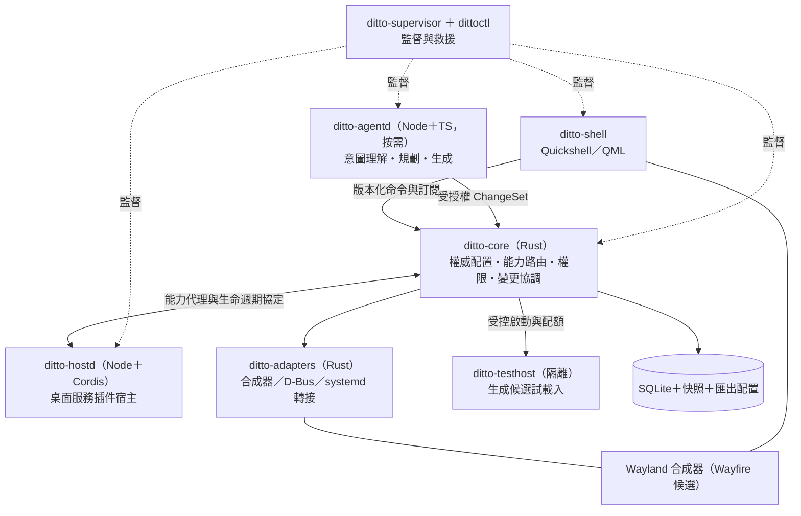

# 01｜目標架構與工程基線

本文把 PRD 第 15 節的分層要求落到可實作的程序、契約與倉庫結構，並列出必須在 G0 凍結的選型。

## 1. 程序與所有權



### 1.1 程序職責與存活規則

| 程序 | 語言 | 存活規則 | 不得做的事 |
| --- | --- | --- | --- |
| `ditto-core` | Rust | 工作階段內常駐 | 不直接操縱 UI 物件；不執行重建置／解析而阻塞主服務；不內嵌第三方原生動態庫 |
| `ditto-shell` | QML／Quickshell | 常駐；崩潰由監督重啟，不得終止原生應用 | 不直接寫入 Core 資料庫；不把逐幀更新送進 RPC |
| `ditto-hostd` | Node＋Cordis | 依 Profile 需求常駐；只有在無啟用服務、訂閱、排程與有效租約後才回收 | 不保存第二份正式 Profile；不套用 Agent 的閒置退出規則 |
| `ditto-agentd` | Node＋TS | 按需啟動；無活動任務／待確認／建置／未移交長任務時閒置 5 分鐘後落盤退出，10 秒內釋放資源 | 不擁有 hostd 的存活決策；不繞過 Core 寫配置；退出不影響已受理變更的提交／回復 |
| `ditto-adapters` | Rust | 隨 Core 啟動（可與 Core 同程序的可信模組，或獨立程序） | 不重做第二套逐幀視窗管理器 |
| `ditto-testhost` | Node 或受限渲染器 | 按任務啟動，受 cgroup／Landlock 限制 | 不得進入主 Shell 或 Core；OOM 不得連帶終止桌面 |
| `ditto-supervisor`／`dittoctl` | Rust | 獨立於 Shell 與 Node | 不隨一般插件更新被替換 |

RUN-02：預設一個可信 Cordis 桌面宿主、最多一個活動 Agent 宿主；隔離工具另計並受配額管理。**不得按訊息或一般插件建立新程序。**

### 1.2 狀態所有權（PRD 第 13 節的實作對應）

| 狀態 | 擁有者 | 儲存 | 更換 UI 時 |
| --- | --- | --- | --- |
| 真實視窗、焦點、顯示器 | 合成器（經 adapter） | 不持久化 | 重新查詢；視窗 ID 不作跨登入身分 |
| Profile、revision、布局意圖、快捷鍵 | `ditto-core` | SQLite＋可匯出文字配置 | 持久保存，與 UI 元件生命週期分離 |
| 能力綁定與權限授予 | `ditto-core` | SQLite | 重新綁定，租約失效後重建 |
| 宿主內插件實例與依賴 | `ditto-hostd`（Cordis fiber） | 記憶體 | 由 Core 依條目列表重建 |
| UI 暫態（焦點、草稿、展開） | `ditto-shell` | 記憶體＋必要時 Core 的 UI 狀態表 | 需要時保存 |
| 長任務與操作結果 | Core 的任務／變更服務 | SQLite | 不因對話面板關閉而遺失 |
| 對話紀錄 | Core 的會話儲存服務 | 檔案（JSONL generation）＋SQLite 索引 | Agent 退出或更換 UI 後仍可查閱 |
| 秘密 | 系統秘密儲存（Secret Service／keyring） | 外部 | Profile 只存引用 |

## 2. 契約與型別產生

### 2.1 傳輸

- **Unix socket**（`$XDG_RUNTIME_DIR/ditto/core.sock`，0600），**換行分幀 JSON-RPC**，沿用 Harness `packages/sdk/protocol` 的訊息形狀。
- 每次呼叫攜帶：`request_id`、`protocol_version`、呼叫方身分綁定、`operation_id`（有副作用者）、取消與逾時語意。
- 事件流攜帶 `seq` 與 `revision`；重連先取快照再補事件；佇列有上限與背壓策略。**不依賴未持久化事件推導唯一真相**（15.2）。
- 協定版本不相容時明確拒絕，不降級猜測（15.5）。
- **身分不可自述**：呼叫身分與授權綁定由受控啟動器／能力代理建立。同 UID、socket 權限與 manifest 自述都不構成插件身分（SEC-11）。

### 2.2 型別單一事實來源

Rust 擁有權威型別 → 匯出 JSON Schema → 產生 TypeScript 型別：

```
crates/ditto-protocol/src/*.rs   (schemars derive)
        ↓ cargo run -p ditto-protocol --bin export-schema
schema/*.json                    (契約產物，進版控)
        ↓ json-schema-to-typescript
packages/protocol/src/generated/ (TS 型別，進版控)
```

- CI 驗證「重新產生後無差異」，與 Harness 的 `verify-cordis-catalog` 同一做法。
- 插件 config 驗證另用 schemastery（Cordis 原生接受 Standard Schema），但**能力契約的權威 schema 在 Rust**。
- 契約版本獨立於顯示名稱與翻譯（MOD-07）。

### 2.3 能力目錄（PRD 15.2 的落地形狀）

每個能力以 seam 三角交付（Definition／Provider／Consumer），描述子至少包含：

```
capability_id        desktop.windows.move
version              1.0.0（契約版本，非套件版本）
input_schema         JSON Schema
output_schema        JSON Schema
errors               封閉錯誤集合，含 unsupported
resource_scope       需要的資源與權限
cancellable          true/false
idempotency          none | key-based | natural
timeout_ms           預設與上限
readback             回讀該操作真實結果的能力 id
provider             插件 id ＋ 宿主 ＋ 租約 id
```

無 `readback` 的能力不得被 ChangeSet 用於宣稱成功（C6）。合成器不支援的操作回傳 `unsupported`，不得靜默成功（DES-03）。

MVP 能力分組：`desktop.capabilities`／`windows`／`workspaces`／`launcher`／`panels`／`appearance`／`commands`／`shortcuts`／`notifications`／`plugins`／`profiles`／`changes`／`jobs`／`permissions`／`agent.sessions`／`agent.providers`／`plugins.development`。

## 3. 變更交易模型

Core 內的 ChangeSet 狀態機（CHG-01～09、14.1）：

```
draft → validated → prepared → applying → verifying → committed
                        ↓          ↓          ↓
                     aborted   rolling_back → rolled_back | partially_applied
```

規則：

1. `validated`：schema、依賴、權限、版本、基底 revision 與前置條件全部確定性檢查通過（不呼叫模型）。
2. `prepared`：保存配置快照與必要狀態快照；候選插件完成健康檢查，**但尚未取得正式獨占資源**（CHG-02）。
3. `applying`：依熱換等級執行。舊供應者停止收新工作 → 排空／取消／交接 → 切換路由，避免重複快捷鍵與命令（CHG-03）。
4. `verifying`：透過 `readback` 讀真實狀態；一致才 `committed`（CHG-04）。
5. 同一配置的提交**序列化**；不同任務可並行準備，提交前重新檢查目標版本（CHG-05）。
6. 取消後停止新增操作；已完成副作用與可回復範圍分開回報（CHG-06）。
7. 送出命令後中斷，一律以 `operation_id` 查詢真實結果，不盲目重試有副作用操作（CHG-07）。
8. 顯示與主要輸入變更採限時回復（CHG-09）：套用後倒數，未確認即自動回復。

**不承諾分散式原子交易**：跨系統副作用採逐步結果與補償。撤銷布局時視窗可能已關閉或螢幕已拔除 → 部分還原並說明差異，不重建不存在的應用狀態。

## 4. 倉庫結構

```
Ditto/
├─ crates/
│  ├─ ditto-core/            權威狀態、能力路由、權限、變更協調、宿主監督
│  ├─ ditto-protocol/        契約型別與 schema 匯出（schemars）
│  ├─ ditto-store/           SQLite、revision 譜系、快照、遷移
│  ├─ ditto-compositor/      Wayland 轉接（wlr-foreign-toplevel、layer-shell、ext-workspace）
│  ├─ ditto-system/          D-Bus／systemd／秘密儲存轉接
│  ├─ ditto-supervisor/      程序健康、重啟風暴、故障隔離
│  └─ dittoctl/              救援 CLI（不依賴 Node 與 Shell）
├─ shell/                    Quickshell／QML
│  ├─ core/                  桌面表面、狀態訂閱、命令呼叫
│  ├─ jelly/                 柔光果凍主題與 token
│  ├─ avatar/                Ditto 角色層與動畫狀態機
│  ├─ chat/                  對話面板、變更卡、上下文標籤
│  ├─ centers/               組合中心、插件中心、變更歷史、個人化、AI 設定
│  └─ providers/             Dock ×2、啟動器 ×2 等可替換 UI 供應者
├─ packages/                 pnpm workspace（Node／TS）
│  ├─ protocol/              產生的 TS 型別 ＋ JSON-RPC client
│  ├─ host-runtime/          ditto-hostd：Cordis 宿主 ＋ ditto-host-loader ＋ 橋接
│  ├─ host-sdk/              插件作者 SDK：manifest 驗證、能力註冊、測試宿主、範例
│  ├─ plugins/               桌面服務插件（含 RUN-10 的兩個非 AI 服務）
│  ├─ agent-runtime/         ditto-agentd：Harness 移植的 Agent 組合
│  ├─ agent-tools/           desktop.* 能力對應的模型工具
│  ├─ generation/            受限模板、生成器、驗證管線
│  └─ testhost/              隔離測試宿主
├─ schema/                   契約產物（進版控，CI 驗證新鮮度）
├─ profiles/                 預設組合：soft-jelly、dev、present
├─ packaging/                工作階段安裝、systemd user units、發行腳本
├─ tests/                    契約測試、故障注入、語意任務集、量測腳本
├─ docs/                     PRD、research、architecture、contracts、移植紀錄
├─ milestones/               本計畫
└─ apps/desktop-prototype/   凍結參考
```

## 5. 待 G0 凍結的選型

| 項目 | 本計畫建議 | 凍結時點 | 備註 |
| --- | --- | --- | --- |
| 參考發行版與版本 | 單一固定發行版，x86_64，參考 GPU | G0 | 同時固定核心版本（Landlock ABI 相依） |
| 合成器 | 優先驗證 Wayfire；備案 Sway／Hyprland | G0 | Quickshell 的工作區整合清單不含 Wayfire，見 [05 風險 R-01](05-risks-decisions.md) |
| Qt／Quickshell 版本 | 固定並鎖定；記錄 QML 模組相依 | G0 | Quickshell API 隨版本變動 |
| Rust toolchain | 固定 stable 版本＋`rust-toolchain.toml` | G0 | — |
| Node 版本 | 固定單一 LTS，同時用於 hostd／agentd／工具 | G0 | 原型現用 Node 22；需與 Cordis vendored fork 相容 |
| Cordis 來源 | 沿用 Harness vendored fork 的鎖定 commit | G1 前 | 理由見 [02-cordis-adoption.md](02-cordis-adoption.md#1-來源與版本鎖定) |
| 模型供應者 | 先接一個，保留替換介面 | G2 前 | 適配器 seam 已在移植範圍 |
| 套件格式與來源 | 核可來源＋本機包，固定版本與雜湊 | G1 | 沿用 pnpm 安裝流程但權威在 Core |
| 秘密儲存 | Secret Service（libsecret）為首選 | G2 前 | 不可用時明確降級並說明，不寫入 Profile |
| 嵌入式腳本引擎 | **不列入 MVP**；QuickJS／Lua 於 P1 另行選型 | P1 | RUN-09；不得成為隱性依賴 |

## 6. 效能與資源的架構性約束

以下不是優化項，是設計時就必須成立的條件（NFR-03／05／06、19.1）：

- **熱路徑不過 IPC**：拖曳、動畫、角色眨眼、視窗跟隨留在 QML／合成器（C10）。
- **訂閱優先於輪詢**：無事件 API 才採有界輪詢並記錄理由；隱藏元件停止非必要渲染與輪詢（RUN-07）。
- **程序數是預算**：預設 Profile 不為每個 UI 插件建立 Node／Worker；重型工作預設最多 2 個並行，超出排隊（RUN-05、NFR-14）。
- **分層計費**：Core ≤80 MiB、Shell ≤250 MiB、Cordis 宿主 ≤100 MiB、Agent ≤150 MiB、10 個小型插件增量合計 ≤50 MiB；Agent 已退出的全桌面 ≤600 MiB、Agent 暖態 ≤750 MiB。全為**待驗證目標**，以 PSS 量測，不與 RSS 相加。
- **診斷不得造假**：同程序插件不可把堆積估算冒充精確獨立 RSS（RUN-08）。
