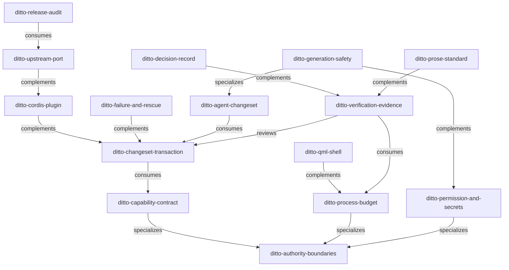

# 04 — 索引與關聯地圖設計

`.agents/skills/` 下有三份治理文件：`AUTHORING.md`（標準速查）、`README.md`（分類索引）、`RELATIONSHIPS.md`（關聯地圖）。本文定義其內容與範本。

## 1. `AUTHORING.md`

[03-authoring-standard.md](03-authoring-standard.md) 的摘要版，供日常引用。

- 內容：目錄與檔名、frontmatter schema、語言政策、正文骨架（含 `## Authority` 規則）、Related Skills 慣例、撰寫檢查表。
- **不含**：與 my-skills 的差異登記與理由（留在 plan/01，避免速查文件變長）。
- 開頭一行指回來源：`完整理由見 [plan/01/03-authoring-standard.md](../../plan/01/03-authoring-standard.md)。`

## 2. `README.md`（分類索引）

沿用 my-skills 的表格形式，加上 Ditto 專屬的「首次需要階段」欄，讓讀者知道哪些 skill 已就位、哪些還在等對應子系統成形。

```markdown
# Ditto Agent Skills

> 專案內生效的 agent skills。撰寫標準見 [AUTHORING.md](AUTHORING.md)；
> 建置計畫見 [plan/01](../../plan/01/README.md)。

這些 skill 把 [PRD v0.4.0](../../docs/product/Ditto-PRD-v0.4.0.md) 與
[milestones/01](../../milestones/01/README.md) 的開發原則轉成可觸發的判斷程序。
skill 不複製權威內容——有疑義一律以各 skill `## Authority` 段落列出的來源為準。

最後更新：YYYY-MM-DD ｜ 共 N 個 skill（Wave 1: n／Wave 2: n／Wave 3: n）

## Category: architecture

| Skill | Status | 階段 | 職責 |
|---|---|---|---|
| [ditto-authority-boundaries](ditto-authority-boundaries/SKILL.md) | stable | G0 | 判定狀態、寫入路徑與決策歸誰所有，以及跨層禁則。 |
| … |

## Category: runtime
…

## 觸發速查

不確定該用哪個？依情境查表：

| 我正在… | 用 |
|---|---|
| 新增一項 `desktop.*` 能力 | ditto-capability-contract |
| … |
```

- 「職責」欄取 [02](02-skill-taxonomy.md) 的單一職責句，一句話，不超過 40 字。
- 「階段」欄填 `milestones/01` 的階段代號（G0～G4），表示首次需要的時點。
- 「觸發速查」直接引用 [02 §4 觸發矩陣](02-skill-taxonomy.md#4-觸發矩陣)，是索引中最常被用到的部分，放在分類表之後。
- 表格由 `scripts/lint-skills.mjs --write-index` 產生，避免與 frontmatter 漂移（見 [06](06-acceptance-and-validation.md)）。

## 3. `RELATIONSHIPS.md`（關聯地圖）

沿用 my-skills 的五種關係詞彙與 Mermaid 圖式，但 Ditto 的 skill 跨分層協作密集，改為**一張總圖＋一張分層依賴表**，而非每個 category 一張圖。

````markdown
# Ditto Skills Relationship Map

> 最後更新：YYYY-MM-DD。關係詞彙沿用 [my-skills 慣例](../../plan/01/04-index-and-relationships.md#4-關係詞彙)。

## 關係類型

| 類型 | 方向 | 意義 |
|---|---|---|
| generalizes | A generalizes B | A 是 B 所屬領域的上游總則 |
| specializes | A specializes B | A 是 B 的特化 |
| complements | A ↔ B | 兩者併用才構成完整能力 |
| consumes | A consumes B | A 取用 B 的產出或資料 |
| reviews | A reviews B | A 評審／稽核 B 的產出 |

## 總圖



## 關係明細

| From | To | 類型 | 說明 |
|---|---|---|---|
| … |（取自 [02 §3](../../plan/01/02-skill-taxonomy.md#3-關係摘要)） |
````

## 4. 關係詞彙

| 類型 | 方向 | 在 Ditto 的用法 |
| --- | --- | --- |
| `generalizes` | A generalizes B | 目前只有 `ditto-authority-boundaries` 對 architecture 類其餘三者成立（以 B specializes A 的方向登記） |
| `specializes` | A specializes B | 下游 skill 是上游總則在特定面向的展開 |
| `complements` | A ↔ B | 兩個 skill 必須同時滿足才算正確，例如交易與故障路徑 |
| `consumes` | A consumes B | A 依賴 B 定義的產物，例如交易依賴能力描述子的 `readback` |
| `reviews` | A reviews B | A 對 B 的產出設下證據門檻，例如驗收之於交易的「完成」宣稱 |

## 5. 同步規則

1. `metadata.related` 是關係的**唯一事實來源**；`RELATIONSHIPS.md` 的明細表與圖由它產生。
2. 新增或修改關係時，**同一個 PR 內**更新雙方的 `metadata.related` 與各自的 `## Related Skills` 段落。
3. `README.md` 的分類表與 `RELATIONSHIPS.md` 的圖表由 lint 腳本的 `--write-index` 模式產生；CI 以 `--check` 驗證無差異（規則 `index-fresh`）。
4. 兩份索引都在開頭標「最後更新」日期，由腳本填寫。

## 6. 導覽入口：根目錄 `AGENTS.md`

skill 需要一個「先讀什麼」的入口，否則每個 skill 都要自己指路。Wave 1 一併交付根目錄 `AGENTS.md`（並以 `CLAUDE.md` 符號連結指向它，沿用 deepseek-harness 做法）。

`AGENTS.md` 的內容界線：

- **只做導覽**：專案是什麼、權威文件在哪（PRD／milestones/01／research）、skill 集合在哪、五條不可違反原則的**清單與連結**。
- **不承載規則細節**：任何需要判斷程序的內容都屬於某個 skill，`AGENTS.md` 只指路。
- 目標長度 ≤ 60 行。
