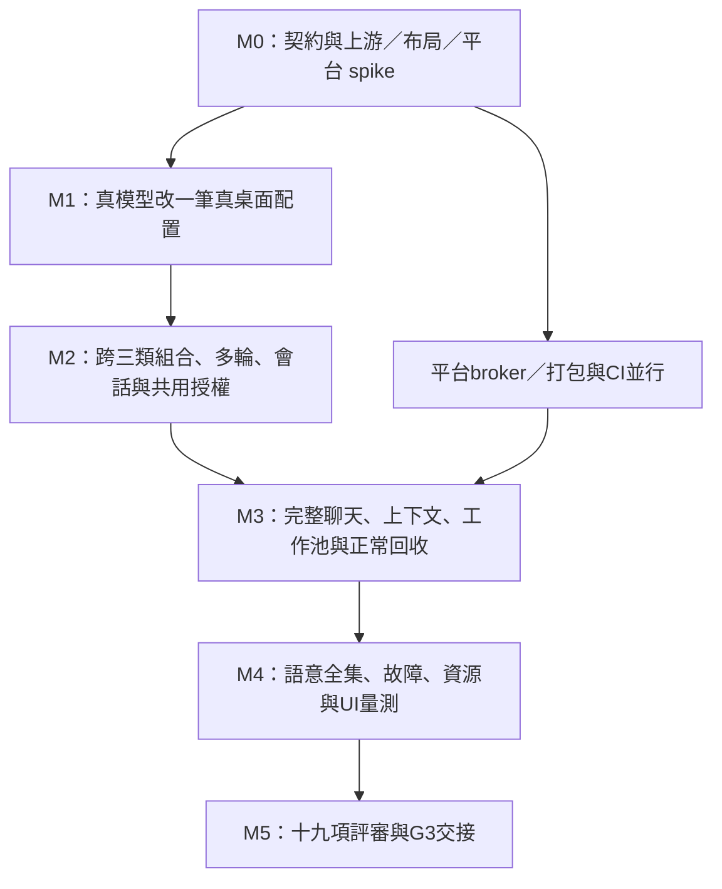

# 08｜工作包、依賴與估算

## 1. 執行方式

原上位28包保留原ID與交付目標；依 D-09a 將第一模型後端改為 Codex，移植 seam 差異由 D-05 明確評審。本計畫原增13包，再加 Codex 3包，共44包。表中的人週是建議量級，不代表已有 staffing 承諾，也未經 AI 協作交付速度校正。依賴寫完整完成條件；第一條垂直流程可以用同包的最小範圍先取證，但不能因此把整包標完成。表內縮寫`CORE-09`等皆指`G2-CORE-09`。

Owner用角色表示，M0由專案owner填具名負責人：AGENT負責Node／模型／工具，CORE負責Rust權威與契約，SHELL負責QML，PLAT負責Wayfire／系統broker與打包，QA負責oracle／真機與量測，DOC由當期技術owner負責。角色可由同一人承擔；每包需一個唯一交付owner，不用假定已有多名工程師。

共通DoD：code與產生物同PR、實際contract可讀、相關正反測試通過、故障與取消語意沒有未交代分支、artifact或diagnostics可查、新增依賴／上游檔有pin／licence／修改紀錄；只有可回讀的狀態才能寫完成。詳情按02～07，行內「交付／證明」為個別DoD。

### 1.1 主要修改落點

這是開工導覽；「新增」欄尚不存在，實作時可依模組大小拆分。既有目錄由同一權威持續演進，不另建一套 G2 Core 或桌面 runtime。

| 工作群 | 既有主要落點 | 新增落點提案 |
| --- | --- | --- |
| CORE-09／10 | `crates/ditto-protocol/src/{lib,catalog,change,rpc}.rs`、`src/bin/export-schema.rs`；`ditto-core/src/{router,authz,coordinator,events}.rs`；`ditto-store/src/changes.rs`；`packages/protocol/`、`schema/` | agent／conversation wire 模組、契約向量；`docs/contracts/` 的新語意文件 |
| CORE-07／08 | `crates/ditto-store/src/{schema,lib}.rs`、既有遷移／backup；Core docops／projection | conversations／preferences Store 模組與 Core service |
| CORE-01～06 | `ditto-core/src/{launcher,identity,router,authz}.rs`、`ditto-store/src/{grants,jobs}.rs`、`ditto-system/src/` | agent_manager、approvals、context、credentials、worker manager |
| AGENT | `packages/protocol/`、workspace／lockfile；`packages/host-runtime/vendor/` 的已鎖 Cordis 來源與紀錄 | `packages/agent-runtime/`、Harness 取用 manifest／adapter、`docs/upstream/harness-g2-port.md` |
| PLAT-01／02／03 | `ditto-protocol/src/profile.rs`、`ditto-core/src/{projection,participants,session}.rs`、`ditto-compositor/src/wayfire.rs`、`ditto-system/src/`；既有登入／build 腳本 | region projection／context helper、Agent 啟動入口與 cgroup 管理 |
| SHELL | `shell/shell.qml`、`core/DittoClient.qml`、`change/ChangeCard.qml`、`avatar/`、`i18n/`、`ui/` | `shell/chat/`、AISettings 與 approval surface |
| QA／DOC | `.github/workflows/`、`tests/g1/`、`tools/presentation-probe/`、`ditto-measure`；既有 notes／decisions | `tests/g2/` suites／oracle／fixtures、G2 出口評審與交接 |

## 2. 原工作包與新增工作包

### 2.1 AGENT（42人週）

必讀：agent-changeset／upstream-port／cordis-plugin，並按寫入與權限觸發authority-boundaries／changeset-transaction／permission-and-secrets。以下skill簡稱均前置`ditto-`。

| ID | 人週 | 依賴 | 交付／證明 | 需求與文件 |
| --- | --- | --- | --- | --- |
| G2-AGENT-01 | 3 | CORE-09、AGENT-12 | 新agent-runtime、受控hello、Cordis組合、ready與dispose；十次同時喚起不產生多Agent | RUN-02；03／06 |
| G2-AGENT-02 | 4 | AGENT-01、CORE-04、CORE-08 | 模型 vocabulary／backend seam 與 provider-neutral 契約；Codex bridge 由 AGENT-14 接通，真文字／tools／abort／usage；D-05 核對 ctx.llm 取用與映射，不拿未使用 API adapter 當完整移植 | 第9節；03／04／10 |
| G2-AGENT-03 | 4 | AGENT-01、CORE-09 | ctx.tools registry與pre→execute→post；schema拒絕、觀察next、單調guard；無run_code可達入口 | 第9節；03 |
| G2-AGENT-04 | 4 | AGENT-01、CORE-07 | Core-backed SessionPersistence／handle；create/open/stat/list/read/append/flush/close、writer失效與export擴充 | RUN-04、CFG-02；02／03 |
| G2-AGENT-05 | 3 | AGENT-03、CORE-09 | 動態catalog schema工具、available／grant過濾、revision cache；移除provider後工具不再執行 | CON-03；03 |
| G2-AGENT-06 | 5 | AGENT-05、AGENT-13、CORE-10、PLAT-01 | intent→ChangeSet、跨3類、多輪target與保護欄位、Profile動作；真模型＋實際diff／geometry | CON-01／02／05／08；03／05 |
| G2-AGENT-07 | 2 | AGENT-06、CORE-02、SHELL-01 | 澄清具體候選與可逆預設、過期回答不執行；中英各含糊／免詢問案例 | CON-04／10；03 |
| G2-AGENT-08 | 1 | AGENT-05 | 按能力說明缺口與組合／安裝／G3路徑；不存在method／plugin不宣稱完成 | CON-11；03 |
| G2-AGENT-09 | 2 | CORE-01、AGENT-04、AGENT-13 | activity／drain／flush／exit；正常5min後10s釋放、active與approval不誤殺 | RUN-03；06 |
| G2-AGENT-10 | 3 | AGENT-13、CORE-10 | 重啟session投影與interrupted task；查op補結果，歷史不重播，unknown不blind retry | RUN-04、CHG-07；03／06 |
| G2-AGENT-11 | 3 | CORE-05、AGENT-03 | bounded job submit／handoff／cancel；一個真CPU工作移出eventloop、第三個排隊 | RUN-05；06 |
| G2-AGENT-12 | 2 | 無 | **新增**：dependency spike、三類port清單與source manifest；裁剪禁用入口、可重建最小組合 | AT-18子集；03／09 |
| G2-AGENT-13 | 2 | AGENT-04、AGENT-03、CORE-10 | **新增**：同步Session事件→async RPC queue與flush barrier；tool前intent落盤、disk fail拒新dispatch | RUN-04／06；02／03 |
| G2-AGENT-14 | 4 | AGENT-02、AGENT-03、AGENT-04、AGENT-05、AGENT-13 | **Codex 新增**：pinned stdio bridge、subscription login／cancel／logout、keyring、model／quota、dynamic tools→Core、ephemeral thread／history、interrupt／crash；無雙重自主迴圈、無 token／tool replay | D-09a、CON-03／09、RUN-04；10 |

### 2.2 CORE（30人週）

必讀：authority-boundaries／capability-contract／changeset-transaction／permission-and-secrets／failure-and-rescue。

| ID | 人週 | 依賴 | 交付／證明 | 需求與文件 |
| --- | --- | --- | --- | --- |
| G2-CORE-01 | 4 | CORE-09、AGENT-01 | Agent manager、generation、單例與活動租約、崩潰／idle；Agent退出不停止coordinator／hostd | RUN-03／06、AT-28；06 |
| G2-CORE-02 | 4 | CORE-09 | 四結果approval與ask/never、intent一次綁定／expiry／CAS；GUI/Agent一致、無UI拒絕 | SEC-02、CON-10；04 |
| G2-CORE-03 | 3 | CORE-02、PLAT-02 | context resource grants、snapshot／token／upload綁定與revoke；每類可用及限制可查 | SEC-03／04；04 |
| G2-CORE-04 | 3 | CORE-09 | Secret Service resolver與create/delete、ref／missing／locked語意；canary不進log/export | SEC-07、AT-15；04 |
| G2-CORE-05 | 2 | CORE-09、CORE-01 | jobs migration、global pool≤2、queue／cancel／budget／Core歸屬；舊install kind語意保留 | RUN-05、CON-06；06 |
| G2-CORE-06 | 2 | CORE-03、AGENT-05 | external data provenance、tool scope與upload最後檢查；繁中英文注入無額外讀／寫／授權 | SEC-06；04 |
| G2-CORE-07 | 5 | CORE-09 | **新增**：Core conversations檔案＋SQLite index、writer、fsync／reconcile／retention／delete；完整故障suite | CFG-02～04、RUN-04；02 |
| G2-CORE-08 | 2 | CORE-09、CORE-04 | **新增**：Core-backed settings、桌面ChangeSet adapter、AI preferences CAS、秘密refs；無YAML寫入 | CFG-05／06、第6節；02 |
| G2-CORE-09 | 3 | 無 | **新增**：新wire／closed vocabulary／scope／catalog／export與版本遷移；共享向量與舊版拒絕 | 第15節、AT-27；02 |
| G2-CORE-10 | 2 | CORE-09、CORE-07 | **新增**：session/turn/tool/op/change/revision原子關聯、query與重連snapshot；lostack可定位 | CFG-02、CON-09、CHG-07；02／06 |

### 2.3 SHELL（18人週）

必讀：qml-shell／prose-standard／process-budget／agent-changeset；授權畫面併permission-and-secrets。

| ID | 人週 | 依賴 | 交付／證明 | 需求與文件 |
| --- | --- | --- | --- | --- |
| G2-SHELL-01 | 5 | CORE-01、CORE-07、CORE-09 | 對話shared state、history／context chips／changes／approval／cancel／undo；QML讀Core結果、分頁 | CON-06／08、第6節；05 |
| G2-SHELL-02 | 2 | SHELL-01、AGENT-13 | 角色七態與文字、真進度；離線／unknown不持續thinking、reduced motion、mask回歸 | AVA-04；05 |
| G2-SHELL-03 | 3 | SHELL-01 | 角色旁panel↔完整window與無角色入口；草稿／history／stream／task20次切換不丟／不重送 | AVA-03／06／07；05 |
| G2-SHELL-04 | 4 | CORE-02、CORE-03、CORE-04、CORE-08、AGENT-14 | AI 連線：Codex 登入／登出、models／effort、quota 狀態；API key 路徑、grants／費用與限額、off／clear；敏感欄位清除、CAS conflict 處理 | 第6節、SEC-07；04／05／10 |
| G2-SHELL-05 | 1 | CORE-01、SHELL-01 | input即時顯示startup、ready與provider等待分離；30次cold時間點可量 | NFR-13；05／07 |
| G2-SHELL-06 | 3 | SHELL-04、AGENT-06、SHELL-03 | skip模型可用桌面、連線後3真能力例子、offline與鍵盤中文；不需avatar也可操作 | 第5.1節、AT-21；05 |

### 2.4 PLAT（12人週，全部新增）

必讀：authority-boundaries／capability-contract／changeset-transaction／process-budget／permission-and-secrets。

| ID | 人週 | 依賴 | 交付／證明 | 需求與文件 |
| --- | --- | --- | --- | --- |
| G2-PLAT-01 | 4 | CORE-09 | Wayfire布局spike、LayoutIntent/schema migration、Core projection／participant／event／rollback；左右geometry可存、窄化可讀 | AT-02／03、CFG-02；05 |
| G2-PLAT-02 | 4 | CORE-09 | 原生file／clipboard／capture broker、probe／fd／bytes／lock與可用性；取得與upload分開 | SEC-03／04、AT-14；04 |
| G2-PLAT-03 | 2 | CORE-01、AGENT-01 | build／install Agent入口、scope／fd身份、dependencies可重建、process診斷；乾淨checkout能啟動 | SEC-09／11、RUN-02；06 |
| G2-PLAT-04 | 2 | CORE-01、AGENT-14、PLAT-03 | **Codex 新增**：binary pin／安裝、private cwd／設定／最小 OS 存取、禁止 builtins 旁路、keyring 最小訪問、整組 cgroup／監督／清理；D-44 實際程序與配額資料 | SEC-03～07、RUN-02／03；06／10 |

### 2.5 QA（22人週）與 DOC（1人週）

必讀：verification-evidence／process-budget／decision-record；security、upstream、QML按suite併讀。

| ID | 人週 | 依賴 | 交付／證明 | 需求與文件 |
| --- | --- | --- | --- | --- |
| G2-QA-01 | 5 | AGENT-06、AGENT-07、AGENT-08、SHELL-01、QA-09 | fixed50＋holdout50、中英／oracle／model pin、真 Codex provider 全run與分項分數；API 替代不抵 Codex 必要驗收 | NFR-12；07／10 |
| G2-QA-02 | 2 | AGENT-10、SHELL-03 | model／RPC斷線、timeout／cancel／重連、offline／無avatar；實際op副作用計數 | AT-11／21；07 |
| G2-QA-03 | 2 | AGENT-06 | GUI／Agent競爭、prepare與base變更、grant revoke race；不覆寫新值 | AT-10；07 |
| G2-QA-04 | 3 | AGENT-09、AGENT-10、AGENT-11、CORE-02、PLAT-03、PLAT-04 | 真idle、crash標定、handoff／OOM／worker limits、100cycle、controller＋app-server 清理、hostd／窗口存活 | AT-24／28、NFR-16；07 |
| G2-QA-05 | 2 | QA-04、QA-09 | 四state三cold-login、PSS／RSS／CPU／GPU／Node欄位、Agent 整組及各 PID、壓力清理與預算判定 | NFR-06／14／15；07／10 |
| G2-QA-06 | 2 | SHELL-02、SHELL-03、SHELL-05、PLAT-01 | **新增**：cold30、chat與launcher warm各200、可見結果、呈現／hotpath RPC、真輸入 | NFR-02／03／05／13；07 |
| G2-QA-07 | 2 | CORE-06、CORE-07、CORE-04、SHELL-04 | **新增**：approval/context/injection/canary/export／delete／crash隱私，真keyring與各broker | AT-14／15、SEC-07；07 |
| G2-QA-08 | 2 | CORE-09、AGENT-12、AGENT-13 | **新增**：CI入口、共享向量／schema／vendor與版本檢查、artifact／去敏、G1host回歸 | AT-18子集／27／30～32；07 |
| G2-QA-09 | 2 | AGENT-14、PLAT-04、SHELL-04、AGENT-10 | **Codex 新增**：auth／模型／quota／工具限制與 OS 正反測試、帳號切換／耗盡、無自動 API、history／interrupt／crash／idle、秘密掃描；資源全集交 QA-05 | EX2-19；07／10 |
| G2-DOC-01 | 1 | QA-01、QA-02、QA-03、QA-04、QA-05、QA-06、QA-07、QA-08、QA-09、SHELL-06 | **新增**：19出口逐項評審、依賴與port紀錄、draft skills核對、未達標／決策與G3交接 | 階段出口；09 |

## 3. 依賴與里程點

| 點 | 必須可示範的結果 | 允許後續尚未完成 | 失敗時處理 |
| --- | --- | --- | --- |
| M0 | 最小Cordis依賴可build；Rust提案與scope可review；布局及keyring/context probe有數據；owner／model待決依賴已明列 | 全部正式UI與LLM工具迴圈 | 先裁剪依賴／選可讀回後端；不轉移Profile權威 |
| M1 | 真 Codex 訂閱登入＋最小聊天入口修改已有配置，經 Core 驗證/readback 呈現，可撤銷；工具限制／OS 最小探測與會話／tool 屏障已工作 | 跨3類、全上下文、完整AI頁面 | 保存失敗不得先執行；backend 無法限制內建工具則拒絕桌面寫入，provider 未連不拿 mock 充數 |
| M2 | 跨布局＋插件＋通知、窄化保持色、Profile操作、基本approval與CAS；跑語意代表題 | 原生全部context、worker壓力、最終surface細節 | 布局缺口回PLAT-01，不能改成無revision的視窗腳本 |
| M3 | core-owned會話／settings、所有上下文類別、兩surface、workpool、idle／reconnect可用 | 完整數字與最後文檔 | OOM或recovery失败先修確定性路径再擴測 |
| M4 | fixed與holdout全run、crash/取消/races、首幀與四statecold量測，各有raw artifact | 出口簽核與G3估算 | 未達標列fail／提案，不改測試範圍掩蓋 |
| M5 | 19項逐項結果、source decisions、skills核對、G3依賴表完整 | G3生成與完整發行 | 明確列未完成／待裁定，不自動宣布出口 |

AGENT-12與CORE-09是起始可並行工作。CORE-07／04／02、PLAT-01／02、QA-08基礎可以在它們的schema範圍凍結後開工；寫在mock上不代表接口已兼容。Critical path大致是CORE-09→CORE-07→AGENT-04→AGENT-13→AGENT-06→QA-01／04→QA-05／DOC；PLAT-01和CORE-04若晚定案也會成為關鍵路徑。

## 4. 第一批可開工 PR

1. **PR-A，AGENT-12＋CORE-09設計與spike**：pin清單、禁用工具的依賴閉包、wire／ownership／scope提案、共享向量框架；同時探測PLAT-01與D-09，產出reviewable選型。
2. **PR-B，CORE-07／10基礎**：schema migration、conversation files、append/flush/writer、durable op correlation與必要query；disk/race測試先建立。
3. **PR-C，AGENT-01＋CORE-01＋PLAT-03最小啟動**：authenticated ready、單例、世代撤銷、可信可執行入口；無provider也能驗證生命週期。
4. **PR-D，CORE-04／08與AGENT-02**：keyring／prefs、模型共用 seam，Codex auth schema spike；沒有 keyring 不塞環境變數越過正式路徑。
5. **PR-E，AGENT-03／04／05／13＋SHELL-01最小入口**：動態工具、Core Session adapter與flush barrier，準備 backend 共用路徑。
6. **PR-F，AGENT-14＋PLAT-04最小垂直範圍**：Codex 正式登入、stdio 初始化、dynamic tool／ephemeral thread、內建工具禁止與 OS 探測；取得 M1 真桌面 artifact。其餘 Codex 故障矩陣繼續完成。
7. **PR-G，PLAT-01＋AGENT-06與CORE-02**：可存布局、跨3類、多輪、共用approval；取得M2代表題。

上述是拆 PR 順序而非把各包提前標 done；其餘原生 context、完整 UI、worker 與量測按依賴接續。PR-F 的最小 probe 不等於完成 AGENT-14／PLAT-04／QA-09；這三包另需完整登入、故障、隔離與帳號矩陣。每 PR 依可 review 大小再拆，interface 與 consumer 未同行時 feature gate 關閉，不能讓使用者走到不存在的 API。

## 5. 週序與估算

假設同時有足夠 Core／Agent／Shell／平台／QA 人力的**相對週序示意**：W1～2 M0、W2～4 M1、W4～7 M2、W6～9 M3、W9～11 M4、W12 M5。這沿用原展示序，新增 Codex 後須依 D-42 重估；沒有實際人力與 spike 數據前不能把 W12 當承諾。一人執行依 PR-A～G 逐段推進，排程改以完成點表示。

| 工作流 | 上位人週 | 本計畫提案 | 增補 |
| --- | --- | --- | --- |
| AGENT | 34 | 42 | 8 |
| CORE | 18 | 30 | 12 |
| SHELL | 18 | 18 | 0 |
| PLAT | 0（含在原包未獨立） | 12 | 12 |
| QA | 14 | 22 | 8 |
| DOC | 0 | 1 | 1 |
| **合計** | **84** | **125** | **41** |

估算預設包含功能、必要測試與文檔，不含 G3 沙箱、發行法務、非參考平台移植、模型帳號等待。相對工期下限為 `125 / (工程人數 × 有效投入比例)`，另受每角色與依賴限制。以75%投入：8人約20.8週、13人約12.8週、16人約10.4週；只是傳統工程容量換算，**不能當作目前 owner＋AI 協作的實際工期，也不能證明關鍵路徑**。平台1人則12人週／75%約16週；若沿用12週展示序，須更多容量或依真實 spike 重估。

D-42由M0／M1實際PR與spike數據重新核定；可縮短實作估算但不能刪除原需求／驗收來湊10～12週。Agent／LLM自動化帶來的速度收益必須用實際交付校正，不套固定倍數。D-12負責具名owner與可用容量；缺人力時只調順序／曆時，不把未做部分寫已完成。

## 6. 卡住的降級與接續

供應者未可用：做Core／契約／UI／mock故障，不計真模型成功。keyring不可用：手動桌面與對話草稿可用，模型連線拒絕，不能plaintext fallback。布局後端缺比例：以經核定floating region方案完成同意圖與readback，若無可回讀路徑則PLAT-01未完成。capture不可用：具體顯示unsupported並保留scope控制，該提供方與出口仍列未完成。量測未達：保留數據與調整提案，繼續不依賴門檻裁定的工作。
