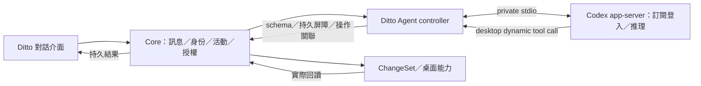

# 10｜Codex 個人訂閱與 app-server 接線

方向依 [D-09a](../../.agents/notes/decisions/2026-10-07-d09a-codex-subscription-app-server.md) 已決。此文件是實作設計與待驗證事項；適用 AGENT-14、PLAT-04、QA-09，以及既有 CORE-01／02／04／07／08／09／10、AGENT-02～05／09／10／13、SHELL-04／05、QA-01／05。技術選型依 skills 的權威、交易、授權、程序與證據邊界核對。

## 1. 接線位置

Codex app-server 有自己的 Agent 執行迴圈。新增提案 `ModelExecutionBackend` 區分 `direct-model` 與 `codex-app-server`：前者由 Harness／Ditto turn-loop 規劃並呼叫模型，後者由 Codex 推進推理與工具請求，Ditto 負責持久化、工具調度與桌面結果。一次 turn 僅選一個後端，不在 Codex 外再跑另一套自主工具迴圈。

一般 API adapter 仍可替換；原 DeepSeek 候選不再是 G2 必要的第一個連線。D-05 要將三類移植的 Definition／Provider／Consumer 對照到真實路徑：Codex bridge 是新增後端，不能假稱為上游 `ctx.llm` 原樣實作；保留所需模型 vocabulary／adapter 契約與測試，工具 dispatcher 與 SessionPersistence 在 Codex 路徑實際使用。原要求的模型移植範圍如需調整，要附取用與執行證據裁定，mock 或未引用程式不算完成。

## 2. 官方依據與本機版本核對

來源於 2026-10-07 檢索：[app-server](https://learn.chatgpt.com/docs/app-server)、[認證](https://learn.chatgpt.com/docs/auth)、[設定參考](https://learn.chatgpt.com/docs/config-file/config-reference)。官方登入、動態工具與 thread/turn 支援是接線依據；實際帳號權限須真實請求驗證，模型清單本身不能證明可用。

本機候選 `codex-cli 0.160.0`，已唯讀產生 440 份 experimental schema。正式版需鎖定 binary 版本／來源／hash／license 及產生物；這是版本候選，不是發行資格證明。外部 Codex schema 放獨立版本目錄，經 adapter 映射成 Rust 定義的 Ditto wire，不取代 Rust-first 契約來源。

實際核對的欄位：`initialize` 的 `capabilities.experimentalApi`；`thread/start` 的 `dynamicTools`／`ephemeral`；`item/tool/call` 的 callId／threadId／turnId／tool／arguments；`turn/interrupt` 的 threadId／turnId。該版 DynamicToolSpec 有 function／namespace 兩種形式，回應有 contentItems／success。**不能直接抄網站示例**：例如該版 thread/start 的 sandbox enum 用 kebab-case，turn sandboxPolicy 用另一定義；adapter 必須以鎖定版本 schema 驗證。

不使用該版標為 internal-use 的 `chatgptAuthTokens` 與 `thread/resume(history=...)` 做正式路徑。完整協定確認與負例屬 QA-09；目前只有產生物驗證，尚無推理與隔離實測。

### 2.1 Adapter 的外部協定工作表

以下為已查到的 Codex 方法，與 [02](02-core-contracts-and-persistence.md) 中尚待實作的 Ditto 方法分開；具體可用性仍以 pinned binary 測試。

| 階段 | Codex 方法／事件 | Ditto adapter 必做 |
| --- | --- | --- |
| 初始化 | `initialize` → `initialized` | clientInfo 與版本；dynamic tools 需 experimentalApi；檢查回應及協定相容，newline-delimited stdio framing／request ID 有界 |
| 登入 | `account/login/start`（type=chatgpt）、`account/login/completed`、`account/updated` | loginId／authUrl 只供受信 UI；generation、expiry 與目前帳號綁定，晚回應拒絕 |
| 管理登入 | `account/login/cancel`、`account/logout`、`account/read` | cancel 綁 loginId；退出／登出撤新請求與舊 thread／活動映射，回讀狀態，不回傳 token |
| 模型／配額 | `model/list`、`account/rateLimits/read`、`account/rateLimits/updated` | 列可選模型／effort、quota 視窗與 reset；真 turn probe 後才宣稱可用，未知不填零 |
| 開始會話 | `thread/start` | ephemeral=true、受限 dynamicTools、指定 model／effort 設定與有效隔離；allowProviderModelFallback=false，unsupported 明確拒絕，不靜默換模型 |
| 執行 | `turn/start`、`item/started`／`item/completed`、`item/tool/call` | text／受權 context 與尺寸驗證；call 映射經 guard／持久屏障／Core，再回 contentItems＋success；事件映射只寫可重建投影 |
| 結束／用量 | `turn/completed`、`thread/tokenUsage/updated` | 持久回答與 usage；桌面成功仍讀 Core verified result，不能將模型 turn completed 直接變成配置成功 |
| 停止／恢復 | `turn/interrupt`、候選 `thread/inject_items` | interrupt 綁 threadId／turnId；恢復先查 Core，再新 ephemeral thread，歷史注入不可重播工具 |

## 3. 登入與設定

預設採 app-server 管理的瀏覽器 ChatGPT 登入。AI 設定的「Codex 個人訂閱」入口請 Core 啟動受控後端，由 adapter 請求登入、開啟系統瀏覽器並等待完成事件；取消／expiry 必須撤登入等待，不能只關視窗。裝置碼為支援且適用帳號下的備援，依所選版本實測。

Codex 有自己的專用設定／狀態目錄，不改使用者現有 CLI 設定、帳號或主工作階段環境。子程序的目錄與設定由受控 launcher 建立；禁止直接沿用開發者家目錄中的 plugins、MCP、hooks、instructions 或 credential file。OAuth token 由 Codex 的 OS keyring 路徑管理，Core 只存 provider account reference／非秘密連線狀態；設定使用 `cli_auth_credentials_store=keyring`，不可選 auto 或 file 讓失敗降成明文。

普通 API key 仍由 Core Secret Service adapter 管理。兩種認證不混用：訂閱登入不要求 API key，也不自動改成付費 API。provider 設定提案是帶 tag 的 union：`codex_subscription` 與 `api_key`，各自驗證必填欄位，Profile export 不含 token／帳號私人資料。

模型選擇從 `model/list` 取得可選項，顯示 reasoning effort 等該版確實提供的欄位，再以真實 turn 驗證帳號存取。未登入、過期、keyring 鎖定、無權模型、rate limit 都有可理解状态，不硬編碼保證某 model ID 可用。登入成功與推理可用分別呈現。

訂閱 UI 顯示配額窗口、使用百分比／重設時間與每 turn token usage；未知欄位標未知。沒有可追溯換算時不顯示每 token API 金額。達限停止新模型請求，保留對話與已受理變更；切其他 provider 需使用者明確選擇，不能自動購買 credit、消耗 reset credit 或發送通知給帳號管理者。

## 4. Desktop 工具與禁止旁路

每次新 thread 由真實 catalog／schema 產生 namespace 或 function dynamic tools，映射可逆且有版本。`item/tool/call` 綁定 Codex callId／threadId／turnId 與 Core session／turn／generation；舊 turn 或未知名稱拒絕。重複 callId 同 payload 回原 operation 結果，不再派副作用；不同 payload conflict。

turn 開始前若 catalog／grant／帳號或 backend 設定版本改變，先結束舊映射，再建新 thread 與工具清單，由 Core 歷史投影接續；不能假設 thread/start 的 dynamicTools 能在既有 thread 任意熱改。執行中即使 schema 尚可見，Core availability／grant 撤銷仍立即拒絕。schema-only 可見但未授權的能力如何提出一次 approval，由受限 Ditto planner／approval adapter 處理，不能直接交 Codex built-in approval 授權。

dispatch 順序仍為 Core grant／approval、Schema、budget、取消、durable tool intent、確定性 ChangeSet、readback。Codex 的 tool response success 只代表該工具結果，不代表所有桌面變更成功；assistant 說完成也不能覆寫 Core result。Core approval 與 Codex command/file approval 不可直接互換；Codex 升權要求預設拒絕，Ditto 自己的工具授權用既有共用路徑。

不能把 app-server 的 command/exec、process/spawn、fs/write 或 config/write 轉給模型作桌面工具。專用配置關閉不需要的 shell／exec、web search、apps／MCP、hooks、memories、multi-agent、remote execution 等；**禁用 key 必須在鎖定版本實測，不假設關閉一個 shell flag 就關閉所有內建能力**。

PLAT-04 建立 OS 可執行邊界：專用空工作目錄，不能讀使用者檔案、Core DB／socket、其他程序憑證或桌面 session bus；只有必需的登入／keyring／provider 通道和受控 stdio。限制檔案／子程序／網路，內建檔案或 shell 路徑即使可見也不得造成未授權副作用。僅 read-only sandbox 仍可能讀完整 home，僅 prompt 禁止也不足；需檢查有效設定、實際能力與攻擊負例。

Linux keyring 常需 session-bus 訪問，與桌面服務阻隔須一併 probe：例如限定服務／介面的 bus proxy 或等效受控通道，確認可登入／refresh／登出且不能呼叫 compositor／其他桌面服務。還須測 keyring item 的 namespace 與存取能力，不能把「使用 keyring」當成 token 已對所有內建工具隔離的證明。此處只列可驗證目標，尚未選定可行的 OS 機制或宣稱完整強制。

若完整禁用／外部強制限制尚未成立，Codex backend 狀態標 unsupported／不可啟用桌面寫入，不能用 approvalPolicy=never 或 danger-full-access 繞過。此限制處理的是已知內建能力，不是增加一般使用者的重複確認流程。

## 5. 對話權威與恢復

Core 仍是對話、訊息、tool/op/change、grant 與偏好的唯一持久權威。首選 `thread/start(ephemeral=true)`，Codex 記憶體 thread 是可重建投影，Core 记录 `codex_thread_id`／`codex_turn_id` 作關聯，不把它們當可跨重啟恢復的唯一鍵。

AGENT-14 在 M0 做 rehydration spike：新 ephemeral thread 注入／提供 Core 中的已完成歷史及工具結果，驗證該版 `thread/inject_items` 或明確資料上下文的受支援形式；歷史不能轉成新的 tool dispatch。模型 context 太長時，用有界、可追溯摘要與相關 recent target 重建，不把丟掉的歷史宣稱完整保存。

官方對 inject_items 描述含 rollout 持久化，不能只因它可注入歷史就假設滿足 ephemeral 限制；必須實測 ephemeral 路徑沒有另存 rollout／私人內容。若該組合不成立，改用有界資料上下文，或提出上段以外的持久化選型評審，不繞過 Core 對話權威。

若不能重建而需持久 Codex rollout，要另提出 authority／privacy／清理提案，不能直接形成第二份正式會話。即使 ephemeral，仍需掃描 state DB／log／telemetry 是否含私人內容，限制並清除後端 cache；不能只檢查 JSONL。

崩潰／斷線恢復先查 Core 的 change/op/job 結果，再建新 thread。模型 turn 取消經 `turn/interrupt`，但已被 Core 受理的 ChangeSet 仍依 Core 取消／提交／回復。把取消模型當撤銷桌面是錯誤；unknown operation 不重新 dispatch。

## 6. 程序與資源

程序提案：一個 Ditto Node Agent controller，加至多一個 Codex Rust app-server，合為一組活動／回收；無額外 Codex worker、sub-agent、MCP daemon 或遠端 execution host。切後端先 drain 舊後端，不同時啟兩個推理迴圈；app-server 退出不停止 hostd。

這新增了實際程序，列 D-44／F2-09 待評審；不能用「一個 logical Agent」掩蓋 PID 或默改 RUN-02 的架構假設。先完成探測，正式定案回寫架構與程序表。使用者已確定 app-server 接入方向，但沒有核定資源門檻放寬。

暖態 Agent **150MiB 以 controller＋app-server＋必要子程序合計 PSS 判定**，另外分列每個程序；完整暖態桌面仍≤750MiB、退出後≤600MiB。原 controller 單程序 memory.max 256MiB 提案不可套兩次冒充同配額；新 cgroup tree／hard limit 依 D-44 量測定案。無活動 5分鐘後整組在10秒內釋放，登入／approval 等待計活動；冷啟動30次測到整組authenticated backend ready，模型首字另報。

## 7. 工作包與驗收

新增 AGENT-14（4人週提案）負責 backend／登入／動態工具／projection／取消；PLAT-04（2）負責受控額外程序、專用狀態與OS邊界；QA-09（2）負責版本相容性及真實帳號矩陣。既有工作包整合各自 Core／Shell／測量，不另建權威。

新增 EX2-19：完成訂閱登入／取消／登出／重新登入；真模型可修改並讀回桌面；未授權內建工具無副作用；模型／配額可讀與達限處理；Core 歷史重建無重播；interrupt／crash／5min idle 整組回收；秘密掃描與完整程序資源報告。須使用實際可用帳號與真機，沒有登入或請求的 schema 檢查不能算通過。

額外測試：帳號切換不沿用舊 account grant／thread；catalog變更後不得繼續 stale dynamic tools；額度耗盡時 GUI 桌面及已受理 ChangeSet 完成；app-server 不可讀另一 session／home／Core socket；production log 與 ephemeral cache 不含 canary token／私人內容。對外發行另核 Codex binary 的來源／license／分發條件，D-11／G4責任不消失。
