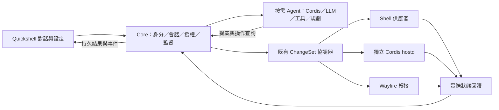

# G2 執行計畫｜對話垂直整合

| 文件屬性 | 內容 |
| --- | --- |
| 文件編號 | DITTO-PLAN-004 |
| 版本／日期 | 1.1.0／2026-10-07 |
| 狀態 | 完整執行提案；尚未實作。選型、估算與加嚴門檻待啟動評審核定 |
| 上位文件 | [PRD v0.4.0](../../docs/product/Ditto-PRD-v0.4.0.md)、[milestones/01](../../milestones/01/README.md) |
| 開工基線 | `main@787b44ac79ef2db1c0f1aaf7b4210da859295085`；G0／G1 依 [D-38](../../.agents/notes/decisions/2026-10-07-d38-g0-g1-owner-acceptance.md) 完成 |
| 上游盤點 | `../deepseek-harness@477b4f420553e8a52c2fbccc464d7561b239c443`，`dsh-0.1.7-rc.2` |
| 交付範圍 | Codex 個人訂閱登入與 app-server、可替換模型後端、兩條改造路徑、Core 持久會話、共用授權、按需 Agent、真實桌面驗收；不實作 G3 生成 |

**G2 的目標：使用者用繁中或英文描述需求，真實模型根據當時可用能力提出 ChangeSet，由 Core 驗證、套用與回讀；對話可以修正、保存與恢復，Agent 退出後桌面照常運作。**

這份計畫以目前程式碼為起點，不把 G1 的歷史開工盤點當作現況。G0／G1 已由 owner 接受完成；剩餘工作依 D-38 追蹤，只有影響 G2 的依賴納入本次工作包，不重開前階段出口。

## 1. 文件導讀

| 文件 | 用途 |
| --- | --- |
| [01 範圍與出口](01-scope-and-exit-criteria.md) | 現況、必要能力缺口、十九項出口與需求追溯 |
| [02 Core 契約與儲存](02-core-contracts-and-persistence.md) | 所有權、協定遷移、會話、設定、操作關聯與事件 |
| [03 Agent 與移植](03-agent-and-upstream-adoption.md) | 上游取用清單、執行迴圈、動態工具、多輪與持久屏障 |
| [04 授權與上下文](04-permissions-context-and-secrets.md) | approval、細粒度 grants、文件／剪貼簿／截圖、秘密與注入防護 |
| [05 Shell 與互動](05-shell-and-interaction.md) | 對話、角色、AI 設定、離線、冷啟動與首次登入 |
| [06 生命週期與故障](06-lifecycle-jobs-and-recovery.md) | 按需啟動、活動租約、工作池、取消、崩潰與回復 |
| [07 驗證與量測](07-verification-and-measurement.md) | 真實模型任務集、故障矩陣、資源／延遲、CI 與證據 |
| [08 工作包與順序](08-workplan.md) | 44 個工作包、依賴、里程點、估算與第一批 PR |
| [09 決策與交接](09-decisions-risks-and-handoff.md) | 待決策、風險、上位計畫回饋與 G3 交接 |
| [10 Codex app-server](10-codex-app-server.md) | 已決訂閱登入方向；執行後端、工具限制、憑證、會話與程序量測 |

閱讀順序：01 → 10 → 02／03／04 → 06 → 05／07 → 08／09。實作某一工作包前再讀該包列出的 skills；權威順序為 PRD > milestones/01 > 本計畫 > skill > AGENTS 導覽。

## 2. 已有底座與真正要新增的部分

| 資產 | 盤點結果 | G2 處理 |
| --- | --- | --- |
| Core 與 Store | workspace 有八個 Rust crates；SQLite schema v1；已有 Profile、revision、ChangeSet、操作紀錄、授權表、套件與 jobs | 沿用交易協調器與唯一寫入者；做前向遷移 |
| 契約 | 協定 `0.2.0`、目錄 revision 4、70 項能力、12 種封閉錯誤；型別來源為 Rust | 新欄位、事件與 origin 的相容性逐項審查；提案升至 `0.3.0` |
| 桌面服務 | `packages/host-runtime`、SDK、tasks／notification policy；與 Agent 分離 | 保持常駐與既有租約；不把服務搬進 Agent |
| Shell | Quickshell、供應者、管理中心、ChangeCard、avatar、i18n、救援與鎖定 | 新對話共享模型；沿用既有卡片與視覺元件 |
| Agent | 只有 G1 測試替身，沒有正式 runtime、LLM、對話儲存或互動授權應答者 | 新增 `packages/agent-runtime`，受控啟動的 `ditto-agentd` |
| 會話 | `crates/ditto-core/src/session.rs` 是合成器事件／快照，不是對話資料庫 | 新增 conversation 模組，避免混用名稱與權限 |
| jobs | 安裝工作紀錄；現有執行中安裝取消並不等於完整可取消工作池 | 擴充 Core 工作狀態與 worker 管理 |
| 布局 | `LayoutIntent` 只有 workspace grid 與 app-id→workspace 規則；現役參與者未提供可保存的左右比例 | 加入可驗證、可回復的區域布局；先探測 Wayfire 實際能力 |
| Dock | `dock_pill` 已支援 left／bottom，manifest 有位置 schema | 首次登入「Dock 移到左邊」可用既有插件組合，不另造 Dock |
| 設定／秘密 | Profile 條目設定已有；AI 設定與 Core-backed Harness settings、keyring 尚缺 | 分離桌面 revision、Core 偏好 revision 與秘密引用 |

上述數量以該 commit 的 `schema/catalog.json`、Rust enum 與 workspace 為準。任何新方法、資料表、路徑或程序在本文都是**實作提案**，不是已可呼叫的 API。

## 3. 設計主線

先做 M1 的真實垂直流程：Codex 訂閱登入 → 文字 → app-server 動態工具 → 一筆可逆配置變更 → Core 回讀 → QML 可見。依 [D-09a](../../.agents/notes/decisions/2026-10-07-d09a-codex-subscription-app-server.md)，Codex 是必要且優先接通的後端；一般 API adapter 保持可替換。app-server 自帶 turn 執行，不能外套第二個自主 Agent 迴圈。接著才擴充跨三類能力、多輪、上下文、完整 UI 與故障矩陣。模型接線不等待全部工作包完成。

## 4. 相對 milestones/01 的增補與加嚴

| 編號 | 發現與處理 | 成本／決策 |
| --- | --- | --- |
| F2-01 | 03 的 G2 出口漏列 04 矩陣首次 G2 的 AT-15／21；列入 EX2-09／10，採較嚴者，不降低需求 | [09](09-decisions-risks-and-handoff.md) 登記待評審 |
| F2-02 | 03 對 AVA-04 說「六態」，列舉與 PRD 實為七態；依 PRD 設計七態 | 不增加獨立需求；SHELL-02 內完成 |
| F2-03 | Core 會話儲存、設定 adapter、操作關聯及協定遷移未有獨立工作包 | CORE-07～10，增 12 人週提案 |
| F2-04 | Harness 三類服務存在更多相依；Session 同步 append 不保證 RPC 落盤 | AGENT-12／13，增 4 人週提案 |
| F2-05 | AT-02／03 所需可保存布局與原生上下文提供方尚缺；Agent 身分打包須可重建 | PLAT-01～03，增 10 人週提案 |
| F2-06 | 真正首幀延遲、秘密與會話隱私、生成契約與測試管線需要專項 | QA-06～08，增 6 人週提案 |
| F2-07 | 三類移植追溯須在 G2 提供；完整 AT-18、未信任候選與生成留 G3 | DOC-01，增 1 人週提案 |
| F2-08 | NFR-12「達標或提調整」不能把未核定調整當通過；固定集 ≥90%，保留集的具體差距另提案 | D-20／D-43；不自行降低目標 |
| F2-09 | 使用者要求 Codex 訂閱＋app-server；新增受控後端程序、OAuth keyring 與 ephemeral thread 映射，須驗證內建工具不可旁路 Core | D-09a 方向已決；AGENT-14／PLAT-04／QA-09 增 8 人週提案；D-44 程序與配額待實測裁定 |

原 28 個工作包與 84 人週全部保留。原缺口增補 13 包／33 人週，加上 Codex 3 包／8 人週，共 **44 包／125 人週提案**；這是範圍估算，不是工期承諾。[08](08-workplan.md) 另列人力與關鍵路徑，未核定前上位估算仍為 84 人週。本文不核定 D-06a／D-44、不調高資源門檻、不宣稱 G2 已完成。

## 5. 維護規則

落地的 wire 欄位由 `crates/ditto-protocol` 產生，語意寫入 `docs/contracts/`；本目錄保留設計與驗收，不維護第二份手寫 TS 契約。每個 PR 附工作包 ID、版本、驗證與限制；新結果寫入將來的 `.agents/notes/gate-reviews/G2-exit.md`，尚未執行的測試保持未執行。待決策只有裁定後才寫入 decisions，提案不冒充決定。
